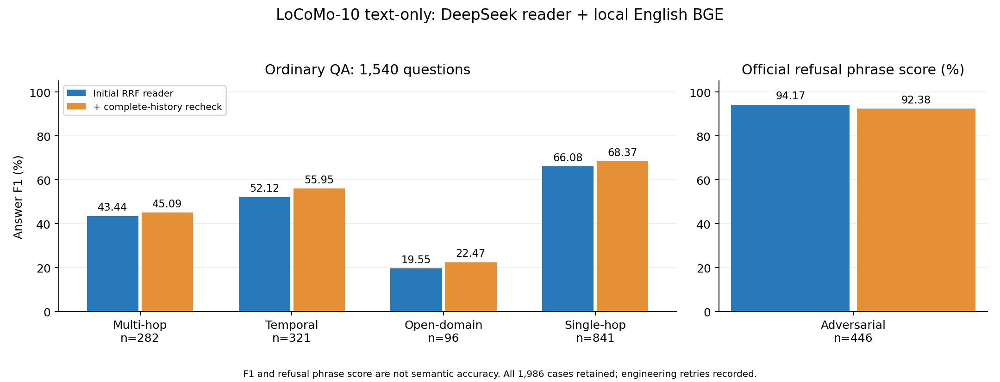

# Memoria-Agent

[中文完整版](README.md) · [Documentation](docs/README.md) · [Research and commercial-readiness plan](docs/plans/长期陪伴记忆研究与实验计划书.md)

Source-backed memory management for small-model companionship: reviewed Claims, conditions, dual-time revisions, source retrieval, dependent views, bounded evidence and account-isolated execution. Memory Studio provides source review, timelines, retrieval diagnostics and read-only run records. The current scope is a local research prototype and controlled-pilot foundation; public commercial readiness and longitudinal quality remain unverified.

## LoCoMo full evaluation

Completed on 2026-10-13: all **1,986 original questions**, 10 long conversations and 5,882 utterances. Reader: **DeepSeek `deepseek-flash`, non-thinking**; embedding: local **`bge-small-en-v1.5`**. This evaluates English source retrieval and answering, without production Claim/View access.

The first four categories and ordinary Overall use upstream-compatible **Answer F1 (%)**. Overall averages all 1,540 ordinary questions, excludes adversarial questions and is not an equal-weight category average.

| Method | Multi-hop<br>282 | Temporal<br>321 | Open-domain<br>96 | Single-hop<br>841 | Ordinary Overall<br>1,540 | Adversarial refusal†<br>446 |
| --- | ---: | ---: | ---: | ---: | ---: | ---: |
| Memoria-Agent: RRF + neighbors, primary answer | 43.44 | 52.12 | 19.55 | 66.08 | 56.12 | **94.17** |
| Memoria-Agent: RRF + neighbors + full-history recheck | **45.09** | **55.95** | **22.47** | **68.37** | **58.65** | 92.38 |

† The adversarial column follows the official literal refusal rule, not F1 or semantic accuracy. Final structured abstention is 410/446 (91.93%). Rows are primary and final outputs from the same cases, not independent experiments or matched external-method baselines.

Primary retrieval combines English BM25 and Dense with RRF, retains ranked candidates and then adds neighboring utterances within a 12,000-character evidence budget. Primary abstention/clarification or invalid output can trigger one complete-history recheck, bounded separately by 240,000 UTF-8 request bytes; exact remote tokens/window remain unknown. The final row therefore uses additional context and calls, and is not a pure RRF or equal-token-budget result.

All 1,986 final cases passed execution/JSON/citation-ID contracts, while 166 ordinary cases still abstained; these checks do not establish answer entailment. Ordinary F1 improved from 56.12% to 58.65%, while adversarial refusal declined from 94.17% to 92.38%. Historical connection failures and unknown in-flight billing remain recorded. See the [full report](docs/implemented/LoCoMo全量评测与英文检索修复.md) and [frozen aggregate](docs/assets/evaluation/locomo-full-20261013.json).

<details>
<summary>Category chart</summary>



[Figure provenance and reproduction](docs/assets/evaluation/README.md#locomo完整1986题2026-10-13); no new inference or scoring.

</details>

## Local setup and startup

Run from the repository root in Windows PowerShell. Preserve an existing private configuration and use the project virtual environment.

```powershell
if (-not (Test-Path .venv\Scripts\python.exe)) { python -m venv .venv }
.\.venv\Scripts\python.exe -m pip install -r requirements.txt
if (-not (Test-Path config.toml)) { Copy-Item config.example.toml config.toml }
Push-Location studio
npm ci --cache .npm-cache
npm run build
Pop-Location
.\.venv\Scripts\python.exe main.py --config config.toml --host 127.0.0.1 --port 2237
```

Open `http://127.0.0.1:2237/studio/`; `/docs` exposes the API contracts and `/api/health` checks process liveness. Studio must be built before starting/restarting the service. It currently offers login, without a signup page:

```powershell
.\.venv\Scripts\python.exe scripts/manage_users.py reserve your_username
.\.venv\Scripts\python.exe scripts/manage_users.py set-password your_username
```

Password entry is hidden and resets revoke sessions. The existing local qin account is already configured. Empty api_token never bypasses the formal login gateway; each server-owned UUID selects its own database, files, workers and MCP configuration.

Choose either remote main/fast with in-process local BGE (`local://auto`), or the local HTTP Qwen/BGE server. The [Chinese startup guide](README.md#模型方案选择一种) includes optional dependencies, protected Key input, private-override precedence and both complete configurations. Weights are ignored and must already exist locally; the BGE download script verifies a pinned public snapshot.

```powershell
# Separate terminal, only when choosing local HTTP inference
.\.venv\Scripts\python.exe scripts/serve_local_llm.py --model model/Qwen3.5-2B --embedding-model model/bge-small-zh-v1.5 --device cuda --port 8080 --max-context-tokens 8192 --warmup
```

MCP and source import are optional, not part of the minimal startup. See [scripts](scripts/README.md), [Studio](studio/README.md), [MCP](docs/implemented/MCP部署与授权.md) and [data provenance](datasets/README.md). No default credentials or synthetic production profiles are included.

## Next work and commercial readiness

Prioritize query-only risk gating and source support after fallback, multi-hop/open-domain evidence coverage and time precision, then registered comparisons with trusted local Reader token budgets and independent holdouts. Production finite-state citation validation and complete request budgeting are implemented; semantic support and general free-text citation validation remain incomplete. Consented continuous personal histories are still needed for Claim/condition/update and long-term studies; independent human research evaluation remains deferred.

Per-user SQLite/WAL is the current storage design. Verified backup/restore, versioned migrations, full account export/deletion and backup retention, cost/resource quotas, SSRF-safe egress, HTTPS trusted proxies, tenant reclamation, readiness/monitoring/alerts, reproducible CI/releases and license inventories remain pending. See the [research and commercial plan](docs/plans/长期陪伴记忆研究与实验计划书.md) and [module documentation](memoria/README.md).

Source manifests belong in [datasets/](datasets/README.md); raw benchmarks, private gold and per-case artifacts stay in ignored data/. Public aggregates and charts live in [docs/assets/evaluation/](docs/assets/evaluation/README.md). Secrets and model weights remain local; old personal history stays unimported. See [AI instructions](AGENTS.md) and [GitHub conventions](docs/implemented/github提交规范.md).
