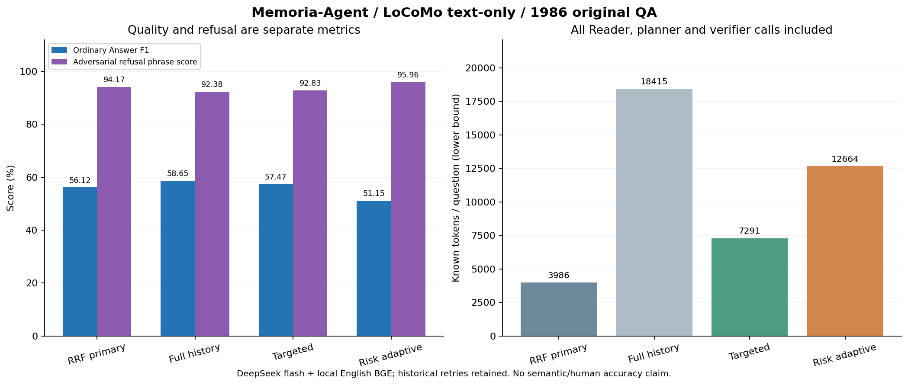

# Memoria-Agent

[中文完整版](README.md) · [Documentation](docs/README.md) · [Research and commercial-readiness plan](docs/plans/长期陪伴记忆研究与实验计划书.md)

Source-backed memory management for small-model companionship: reviewed Claims, conditions, dual-time revisions, source retrieval, dependent views, bounded evidence and account-isolated execution. Memory Studio provides source review, timelines, retrieval diagnostics and read-only run records. The current scope is a local research prototype and controlled-pilot foundation; public commercial readiness and longitudinal quality remain unverified.

## LoCoMo full evaluation

The 2026-10-13 original run and 2026-10-14 P0 ablations use all **1,986 original QA**: 10 constructed conversations, 5,882 utterances, 1,540 ordinary and 446 adversarial questions. Reader: **DeepSeek `deepseek-flash`, non-thinking**; embedding: local **`bge-small-en-v1.5`**. English text only, without images or production Claim/View access.

The four ordinary categories and Ordinary Overall use upstream-compatible **Answer F1 (%)**. Overall averages all 1,540 ordinary questions and excludes adversarial questions; it is not an equal-weight category average.

| Method | Multi-hop<br>282 | Temporal<br>321 | Open-domain<br>96 | Single-hop<br>841 | Ordinary Overall<br>1,540 | Adversarial refusal†<br>446 | Known tokens/QA‡ |
| --- | ---: | ---: | ---: | ---: | ---: | ---: | ---: |
| Memoria-Agent: RRF + neighbors, primary answer | 43.44 | 52.12 | 19.55 | 66.08 | 56.12 | 94.17 | 3986.38 |
| Memoria-Agent: RRF + full-history recheck | 45.09 | 55.95 | 22.47 | 68.37 | 58.65 | 92.38 | 18414.96 |
| Memoria-Agent: RRF + targeted retrieval | 44.30 | 56.29 | 21.20 | 66.48 | 57.47 | 92.83 | 7290.80 |
| Memoria-Agent: sufficiency + risk + adaptive retrieval | 37.45 | 46.49 | 11.07 | 62.10 | 51.15 | 95.96 | 12663.62 |

† Official literal refusal score, not F1, semantic accuracy or structured abstention. Structured refusal: full history 410/446, targeted 413/446, risk adaptive 428/446. The first two rows are original same-batch phases; the last two are independent runs. Frozen QA, declared Reader configuration and local embedding snapshots match; context/call budgets differ. No matched external-method ranking is claimed.

‡ Known usage from every Reader, planner, verifier and engineering retry divided by all 1,986 questions. These are lower bounds, not invoices: unknown historical/in-flight usage is retained, including 1/7 missing-usage calls in the new targeted/adaptive lineages.

Original primary evidence is bounded at 12,000 characters; one full-history recheck can use up to 240,000 UTF-8 request bytes. Targeted retrieval supplements once. Risk adaptive supplements at most twice, with 12,000/16,000/20,000-character evidence stages, at most 6 model calls and 160,000 cumulative input bytes per case attempt. New methods never send the full history to the Reader. Exact remote token windows remain unknown.

**The combined P0 objective is not met.** Relative to full history, targeted uses 60.41% fewer known tokens but loses 1.18 F1 points. Risk adaptive uses 31.23% fewer, improves adversarial refusal by 3.59 points, and loses 7.50 ordinary F1 points. Ordinary abstentions increase 166 → 201 → 400; answered-zero-F1 cases decrease 100 → 90 → 55, without proving fewer hallucinations. Targeted has zero final execution errors; adaptive retains one length-limited verifier failure in the complete denominator. All original failures and recovery costs remain recorded.

Production defaults remain. Optional `use_answer_risk` enables pre/post checks; production adaptive retrieval is pending. See the [P0 report](docs/implemented/证据充分性与风险感知回答.md), [original report](docs/implemented/LoCoMo全量评测与英文检索修复.md) and [plan](docs/plans/长期陪伴记忆研究与实验计划书.md#242-v2完整消融结果与下一步校准). Real longitudinal effects and extraction F1 still require authorized continuous personal sources; independent human review remains deferred.

<details>
<summary>Four-method quality, refusal and token cost</summary>



[Aggregate](docs/assets/evaluation/locomo-risk-full-20261014.json) · [SVG](docs/assets/evaluation/locomo-risk-full-20261014.svg) · [Provenance and reproduction](docs/assets/evaluation/README.md#p0四方法全量消融2026-10-14). No new inference or scoring is performed by the chart renderer.

</details>

## Local setup and startup

Run from the repository root in Windows PowerShell. Preserve an existing private configuration and use the project virtual environment.

```powershell
if (-not (Test-Path .venv\Scripts\python.exe)) { python -m venv .venv }
.\.venv\Scripts\python.exe -m pip install -r requirements.txt
if (-not (Test-Path config.toml)) { Copy-Item config.example.toml config.toml }
Push-Location studio
npm ci --cache .npm-cache
npm run build
Pop-Location
.\.venv\Scripts\python.exe main.py --config config.toml --host 127.0.0.1 --port 2237
```

Open `http://127.0.0.1:2237/studio/`; `/docs` exposes the API contracts and `/api/health` checks process liveness. Studio must be built before starting/restarting the service. It currently offers login, without a signup page:

```powershell
.\.venv\Scripts\python.exe scripts/manage_users.py reserve your_username
.\.venv\Scripts\python.exe scripts/manage_users.py set-password your_username
```

Password entry is hidden and resets revoke sessions. The existing local qin account is already configured. Empty api_token never bypasses the formal login gateway; each server-owned UUID selects its own database, files, workers and MCP configuration.

Choose either remote main/fast with in-process local BGE (`local://auto`), or the local HTTP Qwen/BGE server. The [Chinese startup guide](README.md#模型方案选择一种) includes optional dependencies, protected Key input, private-override precedence and both complete configurations. Weights are ignored and must already exist locally; the BGE download script verifies a pinned public snapshot.

```powershell
# Separate terminal, only when choosing local HTTP inference
.\.venv\Scripts\python.exe scripts/serve_local_llm.py --model model/Qwen3.5-2B --embedding-model model/bge-small-zh-v1.5 --device cuda --port 8080 --max-context-tokens 8192 --warmup
```

MCP and source import are optional, not part of the minimal startup. See [scripts](scripts/README.md), [Studio](studio/README.md), [MCP](docs/implemented/MCP部署与授权.md) and [data provenance](datasets/README.md). No default credentials or synthetic production profiles are included.

## Next work and commercial readiness

Prioritize query-only risk gating and source support after fallback, multi-hop/open-domain evidence coverage and time precision, then registered comparisons with trusted local Reader token budgets and independent holdouts. Production finite-state citation validation and complete request budgeting are implemented; semantic support and general free-text citation validation remain incomplete. Consented continuous personal histories are still needed for Claim/condition/update and long-term studies; independent human research evaluation remains deferred.

Per-user SQLite/WAL is the current storage design. Verified backup/restore, versioned migrations, full account export/deletion and backup retention, cost/resource quotas, SSRF-safe egress, HTTPS trusted proxies, tenant reclamation, readiness/monitoring/alerts, reproducible CI/releases and license inventories remain pending. See the [research and commercial plan](docs/plans/长期陪伴记忆研究与实验计划书.md) and [module documentation](memoria/README.md).

Source manifests belong in [datasets/](datasets/README.md); raw benchmarks, private gold and per-case artifacts stay in ignored data/. Public aggregates and charts live in [docs/assets/evaluation/](docs/assets/evaluation/README.md). Secrets and model weights remain local; old personal history stays unimported. See [AI instructions](AGENTS.md) and [GitHub conventions](docs/implemented/github提交规范.md).
