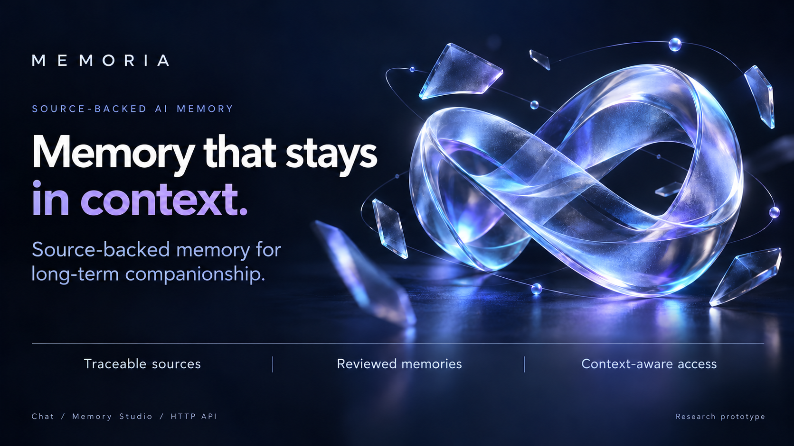
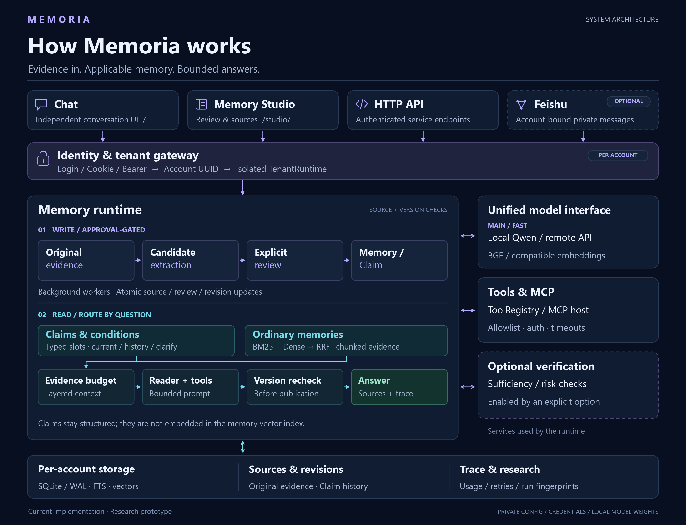

# Memoria

**Source-backed memory for long-term companionship.**

[中文](README.md) · [Getting started](#getting-started) · [Architecture](#architecture) · [Documentation](docs/README.md)

Memoria connects original evidence, review, conditions and revisions so that bounded-context answers can use traceable, applicable memories. It includes independent Chat and Memory Studio interfaces, an authenticated HTTP API, and research tools. The current backend uses DeepSeek with local BGE embeddings. Local Qwen and other OpenAI-compatible configurations remain supported.



The current scope is a local research prototype and a controlled-pilot foundation. Longitudinal quality, positive profile-view benefits and commercial readiness remain unverified.

## Architecture



Claims use typed slots and conditions; ordinary memories use BM25, Dense and RRF retrieval. Evidence budgets and dependency checks constrain publication. Sufficiency and risk verification require an explicit option. See [implementation and limits](docs/implemented/系统架构与实现说明.md). [Poster PNG](assets/images/memoria-overview.png) · [Vector architecture SVG](assets/images/memoria-architecture.svg).

Account-local watermarks, frozen-copy/fixed-pool replay, complete source groups, optional original-experience Dense/RRF, and conservative narrative-update vetoes are now available. The [implementation and tiny budget diagnostic](docs/implemented/生产重放与普通来源支持.md) separate engineering evidence from unverified quality; the complete LoCoMo results below remain frozen.

## Getting started

Windows PowerShell; the locally verified environment uses Python 3.13.5 and Node.js 22.16.0. Keep an existing virtual environment, private configuration and account data.

```powershell
git clone https://github.com/ZJ331456/Memoria.git
Set-Location Memoria
python -m venv .venv
.\.venv\Scripts\python.exe -m pip install -r requirements.txt
if (-not (Test-Path config.toml)) { Copy-Item config.example.toml config.toml }
```

Configure models before starting. The example defaults to a local Qwen/BGE HTTP service on port 8080. Alternatively, use a remote main/fast LLM with in-process local BGE. Model weights are excluded from Git; per-account overrides take priority. See the [complete setup guide](docs/implemented/安装配置与启动.md).

The single [requirements.txt](requirements.txt) groups service, local-model, vector, Feishu, scoring, chart and test dependencies; the install command includes every group. Select an appropriate official PyTorch CPU/CUDA wheel before installing the full list. Frontend and MCP Node dependencies remain separate.

```powershell
.\scripts\cmd\build_frontend.cmd
.\scripts\cmd\start_backend.cmd
.\scripts\cmd\start_backend.cmd -Action Status
.\scripts\cmd\stop_backend.cmd
```

Windows entry points live in [scripts/cmd](scripts/cmd/README.md) and support double-click usage. [scripts/sh](scripts/sh/README.md) is reserved for future Linux launchers; none is implemented yet.

Chat: http://127.0.0.1:2237/ · Studio: http://127.0.0.1:2237/studio/ · API docs: http://127.0.0.1:2237/docs

Both interfaces require normal account registration/login; there are no default credentials. MCP tools and the Feishu private-message channel are optional and require their own configuration and account authorization.

## Latest complete LoCoMo comparison

All **1,986 QA**, from 10 conversations and 5,882 utterances; DeepSeek `deepseek-flash`, non-thinking, with local `bge-small-en-v1.5`. These are frozen v2 measurements; later engineering changes have not been reevaluated.

| Method | Ordinary Answer F1 ↑ | Adversarial refusal phrase score ↑ | Known tokens / QA ↓ |
| --- | ---: | ---: | ---: |
| RRF primary | 56.12% | 94.17% | 3,986.38 |
| Full-history recheck | 58.65% | 92.38% | 18,414.96 |
| Targeted retrieval | 57.47% | 92.83% | 7,290.80 |
| Sufficiency + risk + adaptive retrieval | 51.15% | 95.96% | 12,663.62 |

The 1,540 ordinary and 446 adversarial cases are scored separately. Neither F1 nor literal refusal scores establish semantic accuracy. Known tokens include failures and retries, are lower bounds, and exclude unknown usage. Budgets differ, and no matched external-method ranking is claimed. The adaptive run retains one engineering failure in its full denominator.

**The combined quality/refusal/cost objective is not met; production defaults remain.** [Aggregate](assets/evaluation/locomo-risk-full-20261014.json) · [Protocol and limits](docs/implemented/证据充分性与风险感知回答.md)

<details>
<summary>Quality/cost chart and retained experiments</summary>


The current asset set retains three result families: complete LoCoMo, registered LCCC diagnostics, and evidence selection. Superseded smoke/development exports and duplicate charts have been removed from the current tree. Historical Git revisions and private run ledgers remain traceable. [Assets and reproduction](assets/evaluation/README.md)

</details>

## Repository

- `assets/`: project diagrams, retained result summaries and source manifests.
- `docs/implemented/`: current behavior, operations, evidence and limitations.
- `docs/plans/`: research and readiness work awaiting verification.
- `frontend/`, `memoria/`, `scripts/`, `tests/`: interfaces, implementation, tools and engineering checks.
- Ignored `data/` and `model/`: per-account SQLite/WAL, private evidence, credentials, run ledgers and model weights.

Next algorithm work: source support groups and retraction, progressive retrieval of original experiences, constrained updates and temporary conditions, then matched-budget answer/refusal calibration and valid-view maintenance. These are planned or awaiting verification; current engineering mechanisms do not establish algorithmic superiority. [Code and seven-project comparison (Chinese)](docs/implemented/算法现状与同类项目对照.md) · [Deliverables and ablations (Chinese)](docs/plans/下一阶段算法路线与对照实验.md)

Continuous personal-history effects remain unverified. Backup/restore, migrations, account lifecycle and monitoring remain on the readiness plan. [Plan](docs/plans/长期陪伴记忆研究与实验计划书.md) · [Sources and licensing](assets/data-sources/README.md) · [AI instructions](AGENTS.md)

Routine memories now use model-led admission: extraction, a separate evidence review, and source/risk checks before automatic low-risk publication. Human review handles sensitive, conflicting or ambiguous cases. Studio supports an explicit per-message history request and audit receipts; public corpus data stays separate. See [implementation and limits](docs/implemented/LLM自动审核与人工辅助.md).
