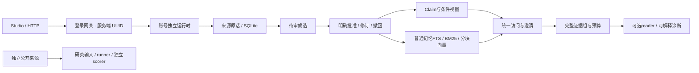
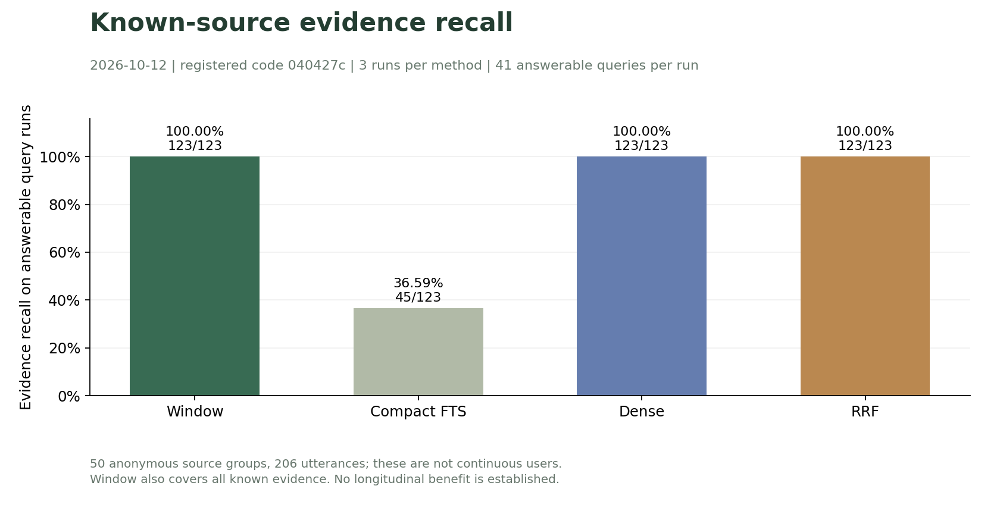
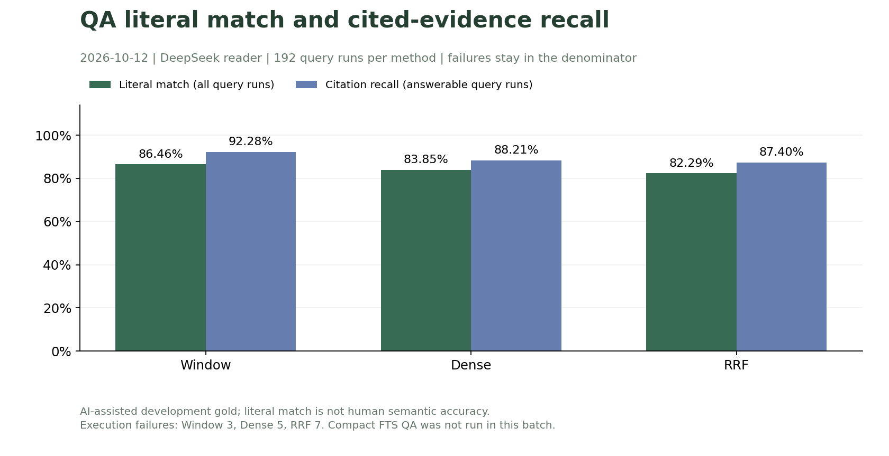
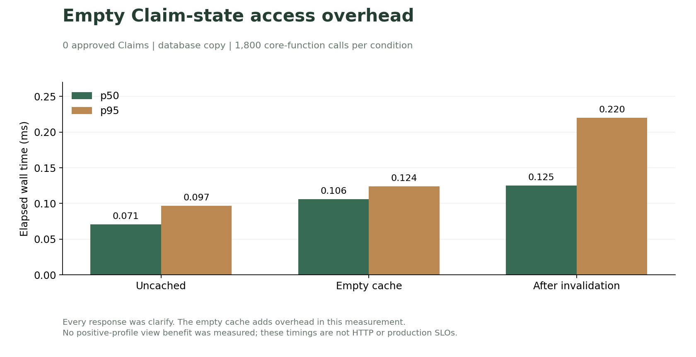

# Memoria-Agent

[English](README.en.md) · [文档导航](docs/README.md) · [研究与实验计划](docs/plans/长期陪伴记忆研究与实验计划书.md) · [AI 协作约定](AGENTS.md)

面向小模型长期陪伴的记忆管理项目：保存原话证据、审核候选、管理条件与变化，在有限上下文中访问适用记忆。入口为 HTTP API、Memory Studio 和研究 CLI，本地 Qwen/BGE 与远程模型使用统一的 OpenAI 兼容业务接口。

**当前定位：本机研究原型与受控试用基础。** 已有工程保护与真实开发评测；真实连续人物长期效果、正向画像视图收益及正式商业发布验收尚未完成。下一步算法、存储、安全和运维验收见[计划 v11](docs/plans/长期陪伴记忆研究与实验计划书.md#18-下一阶段功能优先级与商用准备)。

## 1. 当前能力

| 模块 | 已实现 | 适用边界 |
| --- | --- | --- |
| 来源与个人记忆 | 原话定位、待审批准、去重强化、纠正/撤销/恢复、有效区间、Markdown 投影 | 来源删除、事实删除、账号注销须分别治理 |
| Claim | 12槽位、主体/typed条件、极性/计划、span/SHA、不可变修订与双时间 | 明确审批；支持度是模型建议，通用条件/实体别名待做 |
| 演化建议 | 独立证据风险核验、关系解析、4类更新策略、完整目标复核、抽取影子建议 | 不自动提交；真实F1与长期质量未测 |
| 访问与视图 | 依赖失效、view/retrieve/history/clarify、有限中文区间和来源补检 | 补检不晋升本人事实；普通记忆无完整获知时间索引 |
| 检索与预算 | FTS/BM25/Dense/RRF、BGE完整分块、父版本过滤、整组topk/coverage | 选择器仍为字符预算，reader精确token与B7待验收 |
| Studio | 来源审核、双时间、检索解释、只读执行账本 | 真实账号数据，没有聊天窗口或演示画像 |
| 扩展与身份 | 本地/远程模型、SSE/工具、只读MCP、Skills；UUID独立库/worker/MCP，共享ACL | 业务始终登录；外部内容不自动作为个人记忆 |
| 研究工具 | 来源/标注协议、冻结、输入/gold分离、前缀runner、独立scorer、阶段耗时/指纹 | AI开发gold与真人审核分开，匿名来源不能补成连续个人历史 |



代码职责见[memoria](memoria/README.md)，接口边界见[已实现文档](docs/README.md#已实现的功能说明)。研究链路不将公开匿名来源写入本人Claim。

同日算法深化见[Claim演化策略](docs/implemented/Claim证据核验与演化策略.md)：明确默认只读无条件状态，面试场景按适用条件读取，未给条件继续澄清；影子建议与数据库事务分离。本地HTML展示只保存在忽略目录，不随Git发布。

## 2. 首次准备环境

以下为 **Windows PowerShell**，除注明外从仓库根执行，无需激活.venv。本机路径为`C:\Users\zero\Desktop\Memory-Project\Memoria-Agent`，新机器先获取仓库：

```powershell
# 已有项目不重复clone
git clone https://github.com/ZJ331456/Memoria-Agent.git
Set-Location Memoria-Agent
# 本机可直接 Set-Location 'C:\Users\zero\Desktop\Memory-Project\Memoria-Agent'

if (-not (Test-Path .venv\Scripts\python.exe)) { python -m venv .venv }
.\.venv\Scripts\python.exe -m pip install -r requirements.txt
# 保留已有私密配置
if (-not (Test-Path config.toml)) { Copy-Item config.example.toml config.toml }
.\.venv\Scripts\python.exe -c "import sys; print(sys.executable); print('isolated:', sys.prefix != sys.base_prefix)"
```

本机已验证Python3.13.5、Node22.16.0、npm10.9.2。API最小依赖在requirements.txt；本地模型可选依赖在requirements-local-embedding.txt，向量扩展在requirements-vector.txt。Node用于Studio/MCP。这是当前平台证据，不代表全部系统已验收；不向conda base或全局npm安装项目包。

## 3. 模型方案：选择一种

准备`model/bge-small-zh-v1.5/`，使用本地LLM时另备`model/Qwen3.5-2B/`。模型被Git忽略，clone不会包含权重；本项目没有通用Qwen下载CLI，需有效的本地Safetensors/tokenizer/config。

```powershell
# 本机RTX4060已验证CUDA wheel；CPU机器选择官方CPU wheel
.\.venv\Scripts\python.exe -m pip install torch==2.9.0 --index-url https://download.pytorch.org/whl/cu126
.\.venv\Scripts\python.exe -m pip install -r requirements-local-embedding.txt
.\.venv\Scripts\python.exe scripts/download_embedding.py
```

已有环境/模型时跳过；BGE下载固定revision并核对SHA/大小。驱动与wheel按[Embedding说明](docs/implemented/本地Embedding配置.md)和[PyTorch官方安装表](https://pytorch.org/get-started/previous-versions/)核对。

### A. 远程LLM + 进程内本地BGE

在私密config.toml配置main/fast与embedding；模型名称使用账号可调用的ID，下例为本机历史评测使用的DeepSeek名称。

```toml
[llm.main]
model = "deepseek-flash"
base_url = "https://api.deepseek.com/v1"
api_key = "${DEEPSEEK_API_KEY}"
[llm.fast]
model = "deepseek-flash"
base_url = "https://api.deepseek.com/v1"
api_key = "${DEEPSEEK_API_KEY}"
[memory.embedding]
model = "model/bge-small-zh-v1.5"
base_url = "local://auto"
api_key = ""
```

新机器用环境变量时，在**启动业务服务的同一终端**隐藏输入，不打印Key：

```powershell
$taskSecureKey = Read-Host 'DeepSeek API Key' -AsSecureString
$env:DEEPSEEK_API_KEY = [System.Net.NetworkCredential]::new('', $taskSecureKey).Password
Remove-Variable taskSecureKey
```

本机qin已有账号绑定DPAPI profile，无需重输或覆盖。`data/users/<UUID>/config/models.override.toml`会覆盖槽位，已有覆盖时只编辑config.toml可能不改变实际配置。`configure_research_model.py`仅保存研究profile，单独执行不激活生产；见[脚本说明](scripts/README.md#研究与模型配置)与[统一接口](docs/implemented/本地与远程OpenAI统一接口.md)。

### B. 本地Qwen/BGE共用HTTP模型服务

在**终端一**启动8080，默认config.example.toml对应此方案：

```powershell
.\.venv\Scripts\python.exe scripts/serve_local_llm.py --model model/Qwen3.5-2B --embedding-model model/bge-small-zh-v1.5 --device cuda --host 127.0.0.1 --port 8080 --max-context-tokens 8192 --warmup
# 另一个终端只读确认
Invoke-RestMethod http://127.0.0.1:8080/health
Invoke-RestMethod http://127.0.0.1:8080/v1/models
```

设备可选cpu/auto；本机验证为CUDA。服务提供chat/completions与embeddings，Qwen总输入+输出默认8192 token、BGE单块512 token；health存活不是模型质量证明。warmup加载并运行本地LLM，长文分块由记忆链路执行，直接超长embedding不会静默截断。[完整接口边界](docs/implemented/本地与远程OpenAI统一接口.md)。

## 4. 构建Studio、启动2237业务

先构建，再在**终端二**启动；方案A无需另起8080。

```powershell
Push-Location studio
npm ci --cache .npm-cache
npm run build
Pop-Location
.\.venv\Scripts\python.exe main.py --config config.toml --host 127.0.0.1 --port 2237
```

| 地址 | 用途 |
| --- | --- |
| http://127.0.0.1:2237/studio/ | Memory Studio登录与记忆管理 |
| http://127.0.0.1:2237/docs | Swagger接口契约 |
| http://127.0.0.1:2237/api/health | 业务进程存活，匿名可读 |
| http://127.0.0.1:2237/ | JSON导航 |
| http://127.0.0.1:8080/v1/models | 方案B独立模型服务 |

```powershell
Invoke-RestMethod http://127.0.0.1:2237/api/health
```

Studio503时先构建再重启；端口占用先核对已有服务，不重复起两份。修改模型override后重启业务。当前按单个业务进程运行，多worker租户生命周期、任务和MCP协调尚未验收。

### 首次账号与登录

Studio有登录，没有注册页面；新机器可本机隐藏输入建立自己的账号：

```powershell
.\.venv\Scripts\python.exe scripts/manage_users.py reserve your_username
.\.venv\Scripts\python.exe scripts/manage_users.py set-password your_username
```

用户名3–32位小写英文/数字/下划线，以字母开头，密码12–128字符；也可通过/api/auth/register注册。本机qin已配置，正常登录即可，重设会撤销会话。正式业务始终要求Cookie/Bearer登录，api_token空不免登录。Studio不保存明文密码或Bearer，见[用户隔离](docs/implemented/用户登录与数据隔离.md)。

### 前端开发模式

API保持运行，在第三个终端：

```powershell
Push-Location studio
npm ci --cache .npm-cache
npm run dev
```

访问http://127.0.0.1:5173/studio/，/api代理到2237；部署模式只需构建产物和2237，不需要Vite开发进程。

## 5. 可选MCP与公开诊断来源

这些不是最小启动必需项，仅配置已有账号：

```powershell
.\.venv\Scripts\python.exe scripts/install_mcp.py
.\.venv\Scripts\python.exe scripts/configure_mcp.py --user your_username
.\.venv\Scripts\python.exe scripts/check_mcp.py --user your_username
# 飞书首次私密输入并授权；重授权可加 --login-only
.\.venv\Scripts\python.exe scripts/configure_feishu.py --user your_username
```

依赖在.mcp，凭据按账号隔离；飞书回调http://localhost:3000/callback。安装、握手、授权、业务调用分别核验，详情见[MCP文档](docs/implemented/MCP部署与授权.md)。

```powershell
# 可选公开来源；已有qin语料无需重导
.\.venv\Scripts\python.exe scripts/prepare_real_dialogues.py --limit 50 --user your_username
```

50段/206原话来自LCCC，进入账号实验空间；身份/事件时间未知，不生成本人Claim。旧个人历史仍不导入，来源/许可见[datasets](datasets/README.md)。

## 6. 真实开发评测结果与图表

来自**2026-10-12固定21轮、clean040427c**：12轮纯检索768题次、9轮DeepSeek QA576调用。50匿名来源组/206原话/64题（41可知、23不可知），每条件3轮。gold为AI辅助开发标注，字面匹配不是人工语义正确率。结果不归因于后来新增的Studio/选择器，旧六轮窗口/compact QA未混算。



| 方法 | 可知证据召回 | 空上下文 | 检索p50/p95 ms | 本批QA字面匹配 |
| --- | --- | --- | --- | --- |
| Window | 123/123，100% | 0/192 | 0.003/0.003 | 166/192，86.46% |
| Compact FTS | 45/123，36.59% | 81/192 | 0.537/0.676 | 本批未运行 |
| Dense | 123/123，100% | 0/192 | 11.433/38.011 | 161/192，83.85% |
| RRF | 123/123，100% | 0/192 | 12.062/18.403 | 158/192，82.29% |



Dense/RRF补足compact召回，窗口同样覆盖全部已知证据，本批QA字面表现未超过窗口。失败3/5/7次均保留在192分母，共13次引用越界与2次供应商失败；usage已知574/576，已知353502 token，货币成本未知。首次Dense包含加载，表中百分位不代替极端冷启动或生产SLO。



实际账号一致性副本、0已批准Claim，三个条件各1800次、全为clarify。无缓存/空缓存/失效后p50/p95为0.071/0.097、0.106/0.124、0.125/0.220ms；空缓存增加开销，正向画像视图收益仍未测，不是HTTP/reader端到端指标。编译与失效维护成本另列于[完整报告](docs/implemented/DenseRRF自动评测与视图性能.md)。

追溯[注册协议](configs/research-retrieval-eval-20261012.json)、[公开汇总/图指纹](docs/assets/evaluation/README.md)、[来源/gold](docs/implemented/真实历史标注与评测.md)。连续人物、跨会话长期保持、真实变化恢复、人工陪伴效用和B7收益仍未知。匿名来源不是50名连续用户。

### 查看与重绘

Studio账本只读当前账号执行记录，无任意脚本或gold下载入口。新机器没有私有冻结输入时，不能直接复现完整研究。

```powershell
.\.venv\Scripts\python.exe scripts/research.py --user qin --help
# 仅在已有冻结输入/来源和BGE时运行纯检索，0 reader调用
.\.venv\Scripts\python.exe scripts/research.py --user qin run --mode retrieval --protocol lccc50-codex-dev-qa-20261012-v2 --baseline B2_rrf --embedding-device auto
# 图表只读公开汇总，不运行模型或重新评分
.\.venv\Scripts\python.exe -m pip install -r requirements-docs.txt
.\.venv\Scripts\python.exe scripts/render_eval_charts.py
.\.venv\Scripts\python.exe scripts/render_eval_charts.py --check
```

远程QA需显式allow-remote且可能付费。旧登记ID/预测/gold不得覆盖，新实验建新协议和登记；这里没有一键重跑576次调用。

## 7. 实际数据存储

```text
data/                              # 全部忽略
├─ auth/accounts.db                # 账号、密码摘要、会话摘要、登录尝试
├─ users/<server UUID>/
│  ├─ memory/memoria.db             # 原话/记忆/Claim/审核/视图/索引/任务
│  ├─ markdown/                    # 记忆投影与人工维护内容
│  ├─ config/                      # 账号模型覆盖/MCP
│  ├─ secrets/                     # DPAPI profile/OAuth，不写日志
│  ├─ research/                    # 来源、标注、inputs/gold分离
│  ├─ experiments/<run_id>/         # 私有执行与原始产物
│  └─ reports/                     # 账号报告
└─ legacy/                         # 旧档案封存，未导入
model/                             # 权重/tokenizer，忽略
```

当前每用户SQLite/WAL+本地文件。完整备份/恢复、账号注销/全量导出、备份删除政策、schema版本迁移及跨机凭据迁移尚缺；普通Markdown导出不是完整备份，NTFS/DPAPI也不是整库加密。[商用存储验收](docs/plans/长期陪伴记忆研究与实验计划书.md#18-下一阶段功能优先级与商用准备)。

## 8. 下一步重点与商用缺口

1. **数据可靠性与来源入口并行：** 备份/核验/恢复、迁移版本和删除生命周期；增加无需聊天模型的本人原话/获准连续历史入口，保留身份、时间、授权范围。
2. **精确reader预算与引用约束：** 定位已有13次越界，固定候选/输出ID与失败分母；远程tokenizer无法核验时保留估算，不用BGE token冒充reader token。
3. **持久索引与通用条件：** 后台游标、水位、暂停/恢复、投影原子写、条件/否定/计划/不确定时间/实体别名，保留澄清。
4. **新协议B7，再到真实B3/B5/B6：** 公开来源做选择与引用诊断；真实长期和正向视图需要新的获准连续本人资料，独立真人评估继续暂缓。

商用还需账号/成本/磁盘/队列配额、SSRF出口治理、HTTPS可信代理、租户回收、readiness/直方图/告警、恢复演练、CI/锁定依赖、发布回滚和项目/模型/数据许可清单。有登录页或405项工程测试不等于这些已完成；现阶段无需为了“商用”直接引入多机数据库或Kubernetes。

## 9. 目录与验证

| 目录 | 说明 |
| --- | --- |
| memoria | [核心模块](memoria/README.md) |
| studio | [前端构建与测试](studio/README.md) |
| scripts | [管理员与研究命令](scripts/README.md) |
| configs | [公开角色与协议](configs/README.md) |
| datasets | [真实来源清单](datasets/README.md) |
| deploy | [现有部署资产与边界](deploy/README.md) |
| skills | [项目技能](skills/README.md) |
| docs | [已实现与待实现](docs/README.md) |
| tests | [工程覆盖](tests/README.md) |

```powershell
.\.venv\Scripts\python.exe -m pip install pytest
.\.venv\Scripts\python.exe -m pytest -q
Push-Location studio
npm test
npm run build
Pop-Location
git diff --check
```

2026-10-12的6ea773f工程基线405 passed / 91.20s、前端3项及构建通过；文档刷新不产生新的质量实验。凭据/数据库/原话/模型/运行依赖不进Git。AI读AGENTS，按授权在main遵循[GitHub规范](docs/implemented/github提交规范.md)。
