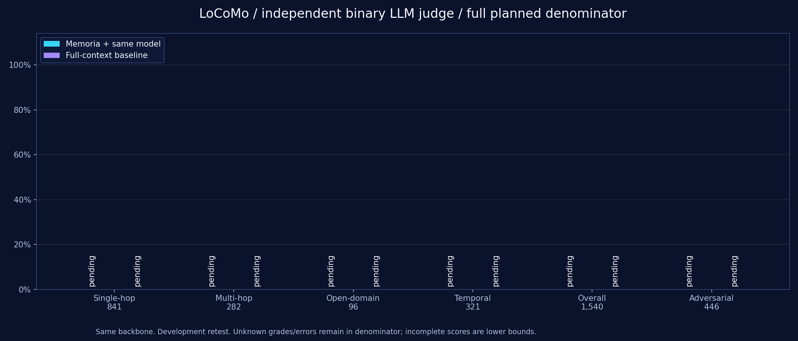

# Memoria

<p align="center"></p>

**面向持续交互的、以可追溯证据为基础的长期记忆内核。**

> 我怎样才能证明：这个系统真的在随着陪伴理解一个人，而且这种能力确实来自我设计的记忆机制？

[English](README.en.md) · [快速开始](#快速开始) · [系统架构](#系统架构) · [评估状态](#locomo-全量评测) · [文档](docs/README.md)

Memoria将原始来源、Observation、Pattern、普通记忆与结构化Claim连接起来，管理形成、审核、条件、时间、版本与撤回。Chat、机器人、文档和任务应用是内核的接入方，记忆不局限于对话。

当前使用DeepSeek与本地BGE，也支持本地/兼容OpenAI格式的模型配置。当前是本机研究原型；真实连续人物的长期效果、抽取F1、因果机制收益及商业发布仍待验证。

最新小批量修复：同一36题，内核执行错误 **8→0**，普通题正确 **6/28→13/28**；完整历史Baseline为 **22/28**。来源绑定和时序回答改善，但尚未证明整体优于Baseline。[完整分类、成本与失败版本](docs/implemented/来源片段绑定与回答稳定性.md)，本轮不追加全量。

2026-10-23：已完成首轮[生产内核 vs 完整历史模型全量评估](docs/implemented/双组内核评估与费用估算.md)，先完成Memoria，再执行Baseline。新结果统一独立LLM二分类；旧分数退出展示，原始账本保留本机。两组各1,986道计划题均已执行；397个执行/评分失败保留完整分母，当前主分未体现框架收益。

本轮增加按独立历史有界并发与欠费熔断，逐题保存完整中间记录。系统架构与下方记忆生命周期图使用所有者章鱼品牌包，不额外生成装饰图片。


## 项目关注什么

| 能力 | 当前实现 |
| --- | --- |
| 独立记忆核心 | [MemoryKernel](docs/implemented/独立记忆核心与多来源接口.md)提供来源存取、统一证据检索与依赖校验；Chat、文档和任务应用共用，保留个人事实与资料边界 |
| 可追溯的记忆 | 保存原话与来源定位；完整支持组、候选审核、纠正、撤销和不可变修订 |
| 记忆形成与巩固 | [有界历史上下文与关联核验](docs/implemented/有界历史上下文与观察关联.md)辅助Observation；单次行为先观察，跨会话积累Pattern并独立审核，支持受约束演化及核心降级 |
| 非对话资料与经验 | [TXT/Markdown/Word DOCX等文本导入](docs/implemented/文本解析与跨资料记忆形成.md)，保存原件与位置；来源感知观察、跨资料巩固、完整支持组和受约束版本演化；本人事实与外部知识分开 |
| 生产闭环诊断 | [按来源前缀重执行](docs/implemented/生产记忆闭环与逐题归因.md)形成、审核、Claim/View或资料Reader；[限额真实调用](docs/implemented/生产记忆闭环与逐题归因.md#claim与view真实调用补测2026-10-20)已覆盖Claim自动发布、冷/热View和撤回失效，不改写LoCoMo冻结成绩 |
| 模拟功能验收 | [固定场景与验收规则](simulation/README.md)覆盖来源、审核、条件、撤回与预算；工程、真实模型功能断言和实际BGE分别验收，不能代替真实数据效果评估 |
| 适用的状态 | Claim、条件视图、明确会话临时范围与双时间；区分当前、历史和未知 |
| 普通观察与事件 | [主体、角色、认识状态与来源时钟](docs/implemented/普通观察主体与事件时间.md)接入对话/资料、Chat/工具/Reader；区分原始时间、事件区间和实际记录时间，日期未知保留未知 |
| 有界的访问 | 普通记忆混合检索；原始经历BM25及可选Dense/RRF、邻块展开、预算和依赖复核 |
| 缺项驱动回答 | [冻结需求→一次定向补检→依赖闭合选择](docs/implemented/缺项驱动补检与依赖闭合回答.md)，区分未召回与未呈现；Chat/机器人及资料Reader共享总预算和发布核验，重排继续默认关闭 |
| 受约束的更新 | 非精确关系先筛主体/属性/条件/时间，未知关系不自动覆盖旧记忆 |
| 独立的使用入口 | Chat 负责对话，Studio 负责资料、审核与来源回查；账号数据隔离 |
| 可核对的研究 | 事务水位、冻结副本/固定池重放，记录来源/模型、实际调用、失败、费用下界与指纹 |

## 系统架构


Claim 按槽位与条件访问，普通记忆使用混合检索；复杂历史问题通过缺项闭环完成有界补检和支持核验，简单读取保留原流程。完整边界见[系统实现](docs/implemented/系统架构与实现说明.md)。[记忆生命周期 PNG](assets/images/memoria-overview.png) · [架构图矢量 SVG](assets/images/memoria-architecture.svg)

## 快速开始

以下命令面向 Windows PowerShell。本机验证环境为 Python 3.13.5、Node.js 22.16.0；依赖安装到项目 `.venv` 和 `frontend`。

### 1. 准备环境

```powershell
git clone https://github.com/ZJ331456/Memoria.git
Set-Location Memoria
python -m venv .venv
.\.venv\Scripts\python.exe -m pip install -r requirements.txt
Get-ChildItem config/*.example.toml | ForEach-Object {
    $taskConfigFile = $_.FullName.Replace('.example.toml', '.toml')
    if (-not (Test-Path -LiteralPath $taskConfigFile)) {
        Copy-Item -LiteralPath $_.FullName -Destination $taskConfigFile
    }
}
```

已有项目直接进入仓库并保留现有环境、私密配置和账号资料。

Python 依赖统一在 [requirements.txt](requirements.txt)，按服务、本地模型、向量扩展、飞书、评测、图表和测试分类注释；上述命令安装全部类别。CUDA 用户应先按[配置指南](docs/implemented/安装配置与启动.md#依赖清单与平台脚本)选择官方 PyTorch wheel，再安装统一清单。

### 2. 配置模型

| 方案 | 需要准备 |
| --- | --- |
| 远程 LLM + 本地 BGE | 在独立模型文件配置 main / fast 的 OpenAI 兼容 API；BGE 使用 `backend="bge"`、本地路径和 device |
| 本地 Qwen + BGE HTTP 服务 | 安装统一依赖清单、准备本地权重，先启动独立的 8080 模型服务 |

运行配置统一在[config](config/README.md)：system.toml管系统，models.toml统一LLM的API/本地选择及Embedding，bot.toml统一飞书/QQ/Telegram机器人，mcp.toml统一MCP定义与账号启用。四份实际文件都忽略，仅提交对应example，没有local子目录。账号专属模型也在models.toml按UUID区分，加密凭据和OAuth仍保存在本人私密数据目录。使用项目venv执行`python scripts/configure_models.py show --user qin`查看实际来源，0推理且不显示Key。[配置与调用方式](docs/implemented/配置目录与模型后端.md) · [安装指南](docs/implemented/安装配置与启动.md)。

### 3. 构建并启动

```powershell
.\scripts\cmd\build_frontend.cmd
.\scripts\cmd\start_backend.cmd
# 查看状态 / 停止
.\scripts\cmd\start_backend.cmd -Action Status
.\scripts\cmd\stop_backend.cmd
```

Windows 入口集中在 [scripts/cmd](scripts/cmd/README.md)，可直接双击；[scripts/sh](scripts/sh/README.md) 为 Linux 预留，当前尚未实现启动脚本。

| 入口 | 地址 |
| --- | --- |
| Chat | http://127.0.0.1:2237/ |
| Memory Studio | http://127.0.0.1:2237/studio/ |
| API 文档 | http://127.0.0.1:2237/docs |

Chat 和 Studio 共用正式登录/注册，项目不提供默认密码。登录后点击用户名账号菜单（Chat左下角、Studio右上角），可切换账号、退出、连接飞书或[修改自己的密码](docs/implemented/用户登录与数据隔离.md#当前账号自助修改密码2026-10-15)，成功后重新登录。Chat采用用户右侧、助手左侧布局，支持Markdown阅读、复制与原文切换。首次账号、开发模式、端口和日志见[启动指南](docs/implemented/安装配置与启动.md)与[后台管理](docs/implemented/本机后台启动与停止.md)。

Studio按日常管理与高级诊断分组。“记忆处理与服务”解释处理进度与当前策略；默认LLM审核低风险候选并自动入库，人工辅助处理敏感、冲突和证据不足。历史原话可点击“LLM提取并处理”，成功后查看长期记忆及版本。公开资料不升格为本人事实，详见[自动审核与人工辅助](docs/implemented/LLM自动审核与人工辅助.md)。结构化Claim、双时间、检索与评测账本的用途和资料前提见首页功能地图。

MCP 工具和[飞书私聊](docs/implemented/飞书机器人对话接入.md)均为可选接入；飞书需正式账号绑定，MCP 文档授权与机器人消息接收分别配置。

## 小批量修复诊断

固定两段完整历史，seed=20261023，各类每段最多随机4题，共36题；普通28题、对抗8题。旧版来自首轮全量的同ID只读切片，新版为[v7独立登记](eval/protocols/kernel-vs-context-judge-v7-date-closure-small.json)的真实调用；同DeepSeek Flash、同Reader输出上限与8,000字符内核证据预算，独立LLM二分类，失败保留计划分母。

| 方法 | 普通题（28） | 对抗题（8） | 执行错误（36） |
| --- | --- | --- | --- |
| 修复前Memoria，同题历史预测 | 6/28（21.43%） | 7/8 | 8 |
| 当前Memoria，v7复测 | **13/28（46.43%）** | **8/8** | **0** |
| 同轮完整历史Baseline | **22/28（78.57%）** | **8/8** | **0** |

同两段历史由原先2条批准/337条待辅助，变为367条批准/6条待辅助，发布3个巩固头；这是形成准入产量，不是抽取F1。修复原文说话人绑定、补检候选一致性、预算重复元数据、必要引用及同原话的事件/日期支持闭合，保留跨来源日期、未知主体和撤回阻断。

多跳与开放域仍弱；当前完整生命周期费用和回答延迟仍高于Baseline，不能只用正确数提升或输入Token减少宣称框架收益。四次开发尝试含所有失败均见[诊断与下一步](docs/implemented/来源片段绑定与回答稳定性.md)及[聚合JSON](assets/evaluation/source-units-small.json)。这些题已用于调试，不作为未见泛化；不以小批量代替下列冻结全量。

## LoCoMo 全量评测

首轮正式比较采用[顺序全量协议](eval/protocols/kernel-vs-context-judge-v3-ordered-histories.json)：**先Memoria完整一组，再Baseline**；同组最多8段独立历史并发，每段库独立、题目顺序执行。相同DeepSeek Flash、非思考、Reader输出上限1024；10段历史、5,882原话，每组1,986题。评分为适配Mem0规则的独立LLM二分类，不是Token F1。

| 方法 | 单跳（841） | 多跳（282） | 开放域（96） | 时序（321） | Overall（1,540） | 已判题数 | 执行错误 |
| --- | ---: | ---: | ---: | ---: | ---: | ---: | ---: |
| Memoria 内核＋同一模型 | 53.98% | 30.85% | 3.12% | 1.25% | 35.58% | 1,602/1,986 | 384 |
| Baseline：完整／截断历史＋模型 | 93.22% | 90.07% | 45.83% | 81.93% | 87.34% | 1,973/1,986 | 13 |

Baseline实际记录1986题上下文，截断0题、最多丢弃0轮；本轮均保留完整历史。

Overall按四类答对总数除以1,540，非四类均值。全部失败/未评分保留原分母；存在未评分时百分比是保守下界，不是已评分子集准确率。类别5不计入主分：

| 方法 | 对抗拒答二分类（446） | 对抗已判 | 全生命周期调用 | 全生命周期费用估算USD | 平均回答阶段延迟 |
| --- | ---: | ---: | ---: | ---: | ---: |
| Memoria 内核＋同一模型 | 92.83% | 428/446 | 7,027 | $3.601–7.202 | 3.58s |
| Baseline：完整／截断历史＋模型 | 91.48% | 445/446 | 3,959 | $0.555–1.109 | 1.43s |

运行状态：**全量计划题均已执行；执行／评分失败已保留**；Run `20261022T180422Z-2bca6b8b`。费用包含形成/审核/巩固、回答/支持/修复及独立评分，按冻结离峰–高峰单价估算，非账单；未知usage不补零。回答延迟含内核检索与支持，但不含形成摊销及Judge；完整阶段费用和耗时见[脱敏聚合](assets/evaluation/current.json)。串行前测已独立保留并计费，不混入本表成绩。

**本轮诊断：** Memoria有384题执行／评分失败，Baseline有13题；失败留在计划分母。 当前完整分母主分未体现框架收益；下一步优先处理覆盖检查契约、来源日期表达、开放域回答策略及必要证据组预算，再以新协议复测。

形成诊断：Observation批准 **15** 条、待辅助 **2409** 条；其中 **2407** 条包含主体绑定缺失原因，已发布巩固版本 **0**。来源窗口中的说话者元数据尚未充分形成唯一主体证据链，当前多数候选未进入有效记忆。下一步先修复绑定及来源时间/覆盖契约，再验证形成机制收益；不绕过审核或为提分伪造本人身份。




两组使用同一骨干；公开对话人物保留外部身份，通过生产Kernel资料域读写，不冒充账号本人。个人Claim/View与个人Dense/RRF不因统一Kernel而自动参与。全部题已用于开发，本次属于同题开发复测；框架整体差异不能证明单一机制因果收益或真实长期陪伴效果。[评分、失败与成本边界](docs/implemented/双组内核评估与费用估算.md)

旧结果退出当前展示。原文、gold、逐题答案、提示词、失败、调用账本和隔离SQLite只保存在本机，不上传远程。

## 仓库目录

```text
Memoria/
├─ config/           # 系统、模型、通讯机器人、MCP各一份私密配置及公开example
├─ eval/protocols/   # 冻结研究登记，与生产配置分开
├─ assets/           # 项目图片、保留评测结果与来源清单
├─ docs/
│  ├─ implemented/  # 已实现行为、操作和验证边界
│  └─ plans/        # 研究路线与待验收事项
├─ frontend/         # chat / studio / shared
├─ memoria/          # 记忆、运行时、模型、API与研究代码
├─ scripts/          # Python/PowerShell工具、模型准备与图表复现
│  ├─ cmd/          # Windows构建、启动、停止入口
│  └─ sh/           # Linux入口预留，尚未实现
├─ tests/            # 工程回归
├─ data/             # 本机账号、原文、配置和实验账本；Git忽略
└─ model/            # 本地模型权重；Git忽略
```

数据目前采用每账号 SQLite/WAL 与本地文件，配置和凭据保持本机隔离。[数据与权限](docs/implemented/用户登录与数据隔离.md) · [来源与许可](assets/data-sources/README.md) · [AI 协作约定](AGENTS.md)

可选使用[DBeaver查看本机数据库](docs/implemented/DBeaver可选数据库查看.md)：按已有账号生成只读连接，检查历史消息、长期记忆、候选和任务。它不参与项目启动，不安装也不影响业务功能。

## 下一步

算法主线：来源感知形成 → 跨会话/跨资料巩固 → 受约束演化 → 同预算质量与成本验证。文本来源、观察、完整支持组及版本机制已有实现；下一步验证真实支持与反证、误合并、错误替代、撤回泄漏和任务复用，不把保存条数或工程测试当作长期效果。已有机制尚未证明同协议算法领先。[当前代码与七个同类项目对照](docs/implemented/算法现状与同类项目对照.md) · [具体交付与消融](docs/plans/下一阶段算法路线与对照实验.md)

真实连续本人效果仍待资料；备份恢复、迁移、账号生命周期和运行监护继续保留。[研究与商用计划](docs/plans/长期陪伴记忆研究与实验计划书.md)
