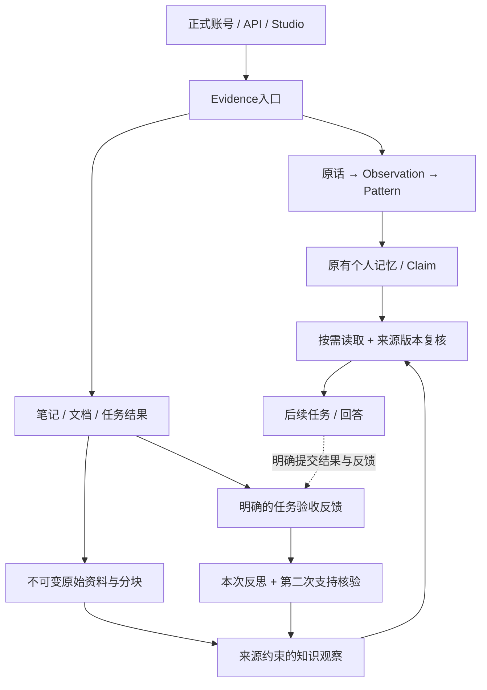

# 多来源资料与任务反馈记忆

[导航](../README.md) · [五层记忆](记忆分层与配置.md) · [形成与巩固](记忆形成巩固与演化.md)

2026-10-18。参考公众号[《我做了一个自进化Agent项目，0实习的同学也有救了》](https://mp.weixin.qq.com/s/1qmJ5PiShtf48fhM3LaGow)，作者由用户确认为“居丽叶的大模型视界”，以及随附架构图。网页可辨识标题，但正文返回环境验证；未确认对应学术论文、未复现文章代码，不引用未读取正文或未核验成绩。

## 三个分层维度

| 维度 | 含义 | Memoria实际落点 |
| --- | --- | --- |
| 系统运行层 | 接入、编排、反馈演化、数据、部署 | 登录网关、AgentRuntime、形成/反馈提炼、SQLite与混合检索、本机脚本；未部署K8s/HPA或MongoDB |
| 记忆作用域 | 工作、用户、部门、全局 | 工作资料绑定会话，私人资料与个人事实按账号隔离；共享复用已有Agent/Space/ACL，未新增跨账号组织目录或自动全局发布 |
| 记忆用途 | 工作、情景、语义、程序、遗忘治理 | 继续使用原五层配置；个人Claim、一般资料和任务经验分别管理 |

不把图片每个方框都变成新服务，也不把部门/全局标签当成已经完成组织权限系统。

## 原生非对话证据

新增[EvidenceLibrary](../../memoria/memory/library.py)，仍使用当前账号SQLite，独立表保存资料、不可变修订、分块/FTS、反馈、知识观察、模型调用和事件。note/document/task_result为来源类型；authorship=self/external/unknown由提交者声明，不代表身份核验。资料不创建会话或user消息，也不自动创建个人memories/候选/Claim；本人上传不证明文档每句话都描述本人。origin仅为来源备注，不抓网页或读取服务器文件。

正文保留SHA256和修订链，更新须携带expected_revision_id；旧版本退出默认检索，明确历史接口可回查。撤回停止使用，保留存储，不称为隐私物理删除。personal可跨本人会话读取；working必须绑定该账号真实会话，工具按服务端RequestContext选择当前会话，会话删除级联清理，尚无自动TTL销毁。SQL先按作用域/head过滤再LIMIT，其他账号和匿名不能访问。

原文800字符分块、80字符重叠，复用中英文词面表示接FTS5/BM25；默认5个来源、4000字符内容预算，同来源优先一个片段。没有另堆资料Dense/RRF，原个人混合检索和结构化Reader保留。多段互补证据、知识卡语义索引待验证。

## 有限反馈闭环

真实task_result须先提交绑定当前版本的验收反馈：报告success/failure/unknown与具体说明。流程结束不代表成功，用户报告也不是独立核验。明确点击提炼才调用当前账号fast优先模型；保存/检索/刷新0模型调用，无新模型配置文件。

第一次调用提出一条有范围的知识观察/本次经验，第二次核验全文支持、适用条件、任务边界和敏感性。任务经验必须同时引用原文与反馈，quote均须唯一原样匹配。ReaderBudget保护完整输入和输出余量，预算不足拒绝，不静默截断证据。单次最多两次阶段调用，同输入成功/待辅助/NOOP复用，固定数量异步锁合并并发重复请求。

通过模型及服务器约束才approved；语义不足/敏感项needs_assistance，不进入可用知识卡。模型等待期间的修订/撤回/新反馈阻止旧结果发表；反馈后来变化也立即停用旧经验。输出长度未完成即使像合法JSON也不发表。阶段usage/耗时/失败保留，供应商失败usage=null，不能记为0费用，无自动无限重试。

后续search_library同时返回原文、有效经验的任务/反馈引用和适用范围，实现数据层经验复用。两次同供应商判断会相关犯错；approved不代表绝对真实，单次反思不证明跨项目通用方法。未自动发布或修改可执行Skills/Hooks/Rules。

## 入口与接口

Studio `/studio/#library` 的“资料与经验”支持文本/Markdown粘贴、保存、阅读、修订、检索、任务反馈、提炼和撤回。界面存personal，working由API明确绑定会话。暂不解析PDF/Office/音频/图片，不监控文件夹或整台电脑。

| API | 用途 |
| --- | --- |
| GET/POST `/api/library/sources` | 列表/保存来源 |
| GET `/api/library/sources/{id}` | 当前原文、版本元数据、反馈和知识观察 |
| POST `/api/library/sources/{id}/revisions` | expected_revision_id/title/content追加修订 |
| GET `/api/library/sources/{id}/revisions/{revision_id}` | 显式查看历史版本，标明is_current |
| POST `/api/library/sources/{id}/feedback` | expected_revision_id/outcome/content，任务反馈 |
| POST `/api/library/sources/{id}/distill` | 明确调用模型提炼/反思，非只读刷新 |
| POST `/api/library/search` | query、可选session_id、limit 1–8、budget 800–8000字符 |
| POST `/api/library/sources/{id}/retract` | 退出使用，保留历史 |

只读search_library进入原每轮记忆读取次数/内容预算，超预算整体拒绝结果。可信依赖由ToolValue服务器元数据携带，发布前复核head/SHA/状态/反馈，模型正文不能伪造。返回`[library:revision_id:start:end]`和原样quote可回查，但尚未对普通资料问答实现个人Claim的完整CitationGuard。逐句引用语义校验、严格文档Reader、多资料支持组和文档自动升格Claim仍待实现。

## 验证与边界

受影响工程组138项通过/60.51秒，随后资料组22项通过/11.68秒，集合重合不相加。覆盖原生资料不造聊天/Claim、中英文span、工作会话/账号隔离、修订/撤回、反馈、支持拒绝、版本竞争、缓存/并发、未知usage及预算/输出长度失败。初次OpenAPI无运行时初始化和测试生命周期夹具问题已修复；最后历史接口及界面修订另做定向检查。前端21项通过，类型与构建通过；最终记录见总计划。

真实检查仅把用户图中可见标签忠实转录到系统临时SQLite，用deepseek-flash发起一次提炼：供应商连接失败，1次调用、usage未知，未生成知识观察，无自动重试或生产资料写入。这不是成功效果，未知费用不记免费。未读取的文章正文未作模型输入，没有新全量LoCoMo，工程输入不进真实账号。

随后在外部连接恢复后作一次限额人工复核，同一真实截图转录、独立临时库，deepseek-flash提炼与支持核验两次均成功，形成1条approved来源观察，原样quote核对成立，已知usage分别578/563，共1141 tokens。保留此前失败，不相减或掩盖；本轮共3次阶段调用，1次失败usage未知，故1141是已知用量下界而非完整账单。未实际验证任务反馈反思质量或长期收益。

部署及最终验证见[总计划50](../plans/长期陪伴记忆研究与实验计划书.md#50-多来源资料与任务反馈分层2026-10-18)。真实长期效果、抽取F1、跨任务反思收益和自动审核precision仍未知。
