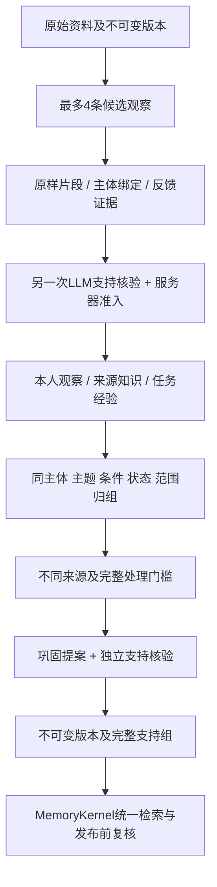

# 文本解析与跨资料记忆形成

2026-10-20。[导航](../README.md) · [独立记忆核心](独立记忆核心与多来源接口.md) · [既有资料接口](多来源资料与任务反馈记忆.md) · [原话形成](记忆形成巩固与演化.md)

## 使用入口

登录`/studio/#library`的“资料与经验”，选择资料类型与作者归属，上传文件或粘贴文本。只有确实由本人撰写才选self；文件所属账号不代表内容都在描述本人。

1. **解析并保存**：不调用模型，保存原始文件、解析文本、SHA、行/段落/表格位置。可查看解析提示、阅读文本、下载原始文件。
2. **形成本段并尝试巩固**：每段最多12000字符、动态4–12项候选额度；一次抽取加一次独立支持核验。逐项隔离及覆盖诊断见[实现说明](观察提取额度与覆盖诊断.md)。界面显示实际处理范围，长文继续下一段；不会把首段完成称为已处理全文。
3. **跨资料积累**：同角色、主体、类别、主题、条件、认知状态及作用域的观察满足不同来源门槛后，最多再调用一次巩固与一次核验。每次形成最多自动尝试一组；其他观察可点击“检查巩固”。不足门槛、无新证据等检查不额外调用模型。
4. **查看和治理**：查看必要原文、主体绑定、任务反馈、适用范围与版本；可以停用具体巩固记忆。需要辅助的观察显示模型审核及服务器准入原因，可修订资料、澄清条件或补足证据后重新形成，未提供任意绕过风险的强制批准。

刷新列表、阅读、保存、检索均不调用LLM。Dense/RRF个人记忆检索可能调用所配置Embedding。供应商内部重试取决于原模型配置；“最多四次”指本次形成的阶段调用数，不冒充完整HTTP重试次数或最终账单。

## 文件解析范围

| 格式 | 当前行为 |
| --- | --- |
| TXT / TEXT | UTF-8、UTF-8 BOM、UTF-16 BOM、GB18030；可显式选编码，自动回退有提示，保留原始换行和字符 |
| Markdown | 保留源文本；界面安全渲染，原始文件仍可下载 |
| CSV | 检查CSV语法，保留原始文本，不执行公式或重新解释业务字段 |
| JSON / JSONL | 校验语法，保留原始序列化，不把字符串拼成虚构对话或用户事实 |
| Word `.docx` | 按OOXML顺序读取正文、表格单元格、页眉页脚及脚注/尾注文字；保留段落/表格位置和标题样式；表格同一行单元格用TAB分隔 |

旧二进制`.doc`须先在Word中另存为`.docx`。本轮不接PDF、图片、音视频或OCR；DOCX内图片不识别，公式不做线性化，批注不导入，动态域不执行，均有提示。页眉页脚等附加部件不代表实际分页顺序，不生成未经版式引擎确认的页码。复杂布局、合并单元格语义和公式解释不属于已实现能力。含未确认修订、宏、加密或外嵌文档块的文件明确拒绝，不默默接受修改。

[document_parser.py](../../memoria/memory/document_parser.py)使用标准库ZIP/XML读取文字，不启动Office进程，不读取外链。依据[WordprocessingML结构](https://learn.microsoft.com/en-us/office/open-xml/word/structure-of-a-wordprocessingml-document)实现所述文本子集，参考[Python XML安全说明](https://docs.python.org/3/library/xml.html)和[ZIP文档](https://docs.python.org/3/library/zipfile.html)限制资源；这些限制是工程选择，不是Office完整兼容认证。

单文件上限1 MiB、正文120000字符、文本20000行；DOCX展开总量8 MiB、2000成员、XML 50000节点/128层，并限制异常压缩。重复成员、异常路径、DTD/实体声明拒绝；不解压到服务器目录。若系统max_request_bytes设置更小，原网关限制优先。无法完整解析时整体拒绝，不静默截取文件后声称成功。

## 保存、修订与来源定位

[FileSources](../../memoria/memory/file_source.py)将原始字节及manifest保存到当前账号SQLite的library_files，绑定不可变revision；没有全局上传目录或新的配置文件。保存file SHA、解析文本SHA和字符位置，原件不可更新，工作资料随所属会话级联清理。API只接收上传字节，filename不作为服务器文件路径读取。

字符span指**解析文本的Python字符位置**，不是压缩包字节、Token或Word页码。TXT原换行保留；Word文字按上述规则构成规范文本，原件SHA另存。修改解析正文产生新revision，新文本不能继续冒用旧原件指纹；旧原件可按明确旧revision回查。撤回停止检索和下载，历史仍保留在数据库与备份，不称为物理隐私删除。

上传时间只是系统记录时间，Word文件属性不当作事实发生时间；缺失事实时间保留未知，个人Claim的双时间仍走原权威接口。

## 来源感知形成

[source_formation.py](../../memoria/memory/source_formation.py)扩展原EvidenceLibrary，复用当前账号模型和ReaderBudget，并将通过核验的观察保存为原library_cards及绑定元数据；没有将资料伪装成用户消息。



| 观察角色 | 准入与边界 |
| --- | --- |
| personal_observation | 本人撰写声明与明确self原话同时成立；单次行为不自动变长期习惯，不创建本人Claim |
| source_knowledge | 第三方/未知作者文字保留来源归属；事实/知识两种标签在此角色内归一为knowledge，不改变原文语义 |
| task_experience | 必须有绑定当前revision的明确反馈；unknown可保留报告观察，不作为已成功经验进行巩固 |

主体、主题、条件、肯定/否定、asserted/observed/plan等分别保存。未知主体、外部第一人称、条件不明、敏感项或支持不足不自动放行。没有新增可用信息可以返回空观察，缓存该决定；缺项/重复的审核ID、非法JSON或输出长度未完成均不发表。

这里的独立核验指另一次模型调用，并非独立真人审核或现实核验；同一供应商/模型可能相关犯错，Supported不能当作事实真值或precision成绩。

形成总开关也约束显式“检查巩固”，关闭时不再发起这类模型请求；若系统改为manual审批策略，已有观察的显式巩固不能绕过策略自动批准。默认仍为LLM主审、风险辅助。

主体不必出现在同一句价值引文中：支持**主引文 AND 独立主体引文**，两者都记录同一revision的原样span；唯一且精确命名的根标题也可提供主体绑定。Markdown标题计数排除围栏代码注释，DOCX根标题使用解析样式。文件名和上传者不是主体证据，未知代词不自动合并为同一人物。上述规则仍是有限绑定；通用实体别名、同名人物消歧及现实身份独立核验未完成。

引用在明确选择的文本段内唯一匹配，保存全局字符跨度；仅允许CRLF/CR与LF的无损位置映射，最终入库仍为原文真实片段，不用模糊改写替代证据。任务还必须引用原始反馈。凭据样式先拦截，不发送给模型；语义核验Supported也不能绕过主体/来源/风险门槛。

长文按显式段范围处理，成功尝试的区间合并覆盖当前revision全文后才允许跨资料巩固；覆盖同时绑定当前反馈及形成策略，旧反馈下处理过的段不能替新反馈补齐覆盖。这表示全部解析文本段均完成一次形成/核验尝试，不代表每句话都抽出、理解或成为事实。失败的段不计覆盖，首段成功不悄悄自动付费处理剩余全文。重复同版本/反馈/段请求复用回执，expected_revision_id防止界面拿旧原文处理新版本。

原文检索附带的单来源观察也返回其原样主引文/位置、独立主体证据及归组，不只返回归纳句。dependency中的card_ids随回答发布前检查：批准状态、当前版本/反馈、原话、主体和保留期须仍成立；过期或被停用的观察不能随仍可读取的原文继续注入。核心完整JSON预算同时包含这些证据，不截断主体引文来腾位置。

## 跨资料巩固与演化

归组键包括角色、主体、类别、主题、条件、认知状态、personal/working及工作会话。只做有限字符串规范化及模型建议对齐，不声称任意同义主题都能归组。默认至少3个不同来源，可在原config/system.toml的`[memory.formation].document_min_sources`设3–8；每组最多使用8份来源、最多64条有界候选。

同source、同解析文本SHA、同原件SHA或相同明确URL/事件来源的副本不会增加支持数；不同ID/字节仍不证明现实来源独立，返回independence字段保留这一限制。个人观察、外部知识和任务经验不交叉拼接，不把相反极性强行选一个；显式冲突进入待辅助状态。

| 决策 | 服务器限制 |
| --- | --- |
| ADD | 无现有有效头时新增自动巩固结论 |
| REINFORCE | 结论及适用范围不能改变；新增完整支持组作为OR替代依据，不因副本加“可信度” |
| UPDATE / MERGE | 仅限同组的一条自动头；新版本只用自己的完整组，不能借旧版本给新结论续命 |
| NOOP | 缓存决定与成本，不强造结论；不能借NOOP跳过对新增证据的核验 |
| RETIRE | 模型仅作待辅助建议；真正停用须用户明确请求并匹配expected revision，不删原文 |

支持表达为`Group A OR Group B`，每个Group内部所有必要观察/主体/任务反馈为AND。来源修订、反馈变化、撤回、保留期失效或工作会话删除阻止旧组继续使用；另一完整适用组仍在才保留。原有retention_days用于派生观察/巩固的保留期，原始资料不因此删掉；阈值尚未做效果校准。

同组新增未纳入核验的不同证据先使旧结论暂不可用于回答；新巩固核验还检查未选观察，防止省略反证。提交时事务重验原始字节/反馈、候选池和expected head；并发旧提案不能覆盖新头。版本、观察及形成回执不可UPDATE，停用写根状态并保留审计。没有自动接管人工记忆、个人Claim或可执行技能。

形成成功而巩固失败时，返回completed观察和独立的consolidation.failed阶段，保留调用usage及事件，不把已形成观察重新报成抽取失败。未知usage仍为null，不记作0成本。没有无限后台重试。通过的巩固进入MemoryKernel的library域，representation=consolidated_memory，与原始资料按名次轮转；完整必要引文、主体/反馈、引用及依赖全部计入JSON预算，超额整体省略，发布前重验。

## 核心和HTTP接口

```python
from memoria.memory.source_formation import FormRequest

# kernel由可信宿主按账号创建；只有真实本人笔记才声明self。
source = kernel.ingest_file("notes.docx", file_bytes, kind="note", authorship="self")
receipt = await kernel.library.formation.form(source["id"], FormRequest(
    expected_revision_id=source["revision"]["id"], start=0, max_chars=12000))
```

全部接口仍走Cookie/Bearer网关，账号UUID不能由请求体指定；工作检索按会话范围，其他账号、匿名及跨范围读取拒绝。

| API | 行为 |
| --- | --- |
| POST `/api/library/import` 或 `/api/memory-kernel/import` | 原始二进制body、application/octet-stream；query filename/title/kind/authorship/scope/session_id/encoding，返回201 |
| GET `/api/library/sources/{id}/file?revision_id=...` | 同账号明确来源原件下载；withdrawn不下载 |
| POST `/api/library/sources/{id}/form` | FormRequest；显式模型调用，最多形成四条观察并尝试一组巩固 |
| GET `/api/library/sources/{id}/observations` | 当前来源观察、可用性、归组及覆盖状态，只读 |
| POST `/api/library/observations/{id}/consolidate` | 明确检查该组；不满足门槛0调用，满足后最多两次阶段调用 |
| GET `/api/library/consolidations?session_id=...` | 当前范围头及最近50条版本元数据；不可用派生内容不返回 |
| POST `/api/library/consolidations/{key}/retire` | expected_revision_id和可选工作session_id，停用且不自动恢复 |

`MemoryKernel.read('library','consolidation:'+root_id)`可读当前巩固；search_knowledge同用核心及每轮预算。个人状态/双时间仍用原Claim访问；资料观察没有直接升格为本人Claim。旧distill为单条来源知识提炼，不执行此跨资料管线。

## 验证与下一步

开发组122项/71.46秒、196项/134.33秒，扩展组423项/222.56秒；主体证据等后补定向组143项/88.84秒，Word标题绑定单例1项/1.99秒。集合重叠不相加，最终定向与部署记录见[总计划52](../plans/长期陪伴记忆研究与实验计划书.md#52-纯文本文件解析与来源感知巩固演化2026-10-20)。前端22项通过/44.80秒，类型检查及Vite构建通过/23.81秒；不将构建写成完整GUI验收。

限额真实检查仅使用`78f9234`公开README（5893字符），临时SQLite、deepseek-flash：两轮各两次阶段调用，已知usage为7956/7890，共15846 tokens；没有生产资料写入或全量LoCoMo。两轮各抽取四条、初始主体句内限制均待辅助；修复独立主体/根标题证据后，使用保存的真实返回作离线服务器准入重放，四条及主体span通过，0新增模型调用。重放不是新的模型判断或效果成绩；单来源不能证明跨资料质量或长期理解能力。

下一步需要获准的真实多资料、必要支持/反证和身份标签，做原文/加观察/加巩固/加演化的同Reader同总预算对照。跨来源语义合并precision、误替代/错误遗忘、实体消歧、资料到Claim正式绑定、严格文档逐句CitationGuard和任务迁移收益仍未验证；真实连续个人效果、抽取F1及商业账号/物理删除生命周期继续保留原待实现边界。
