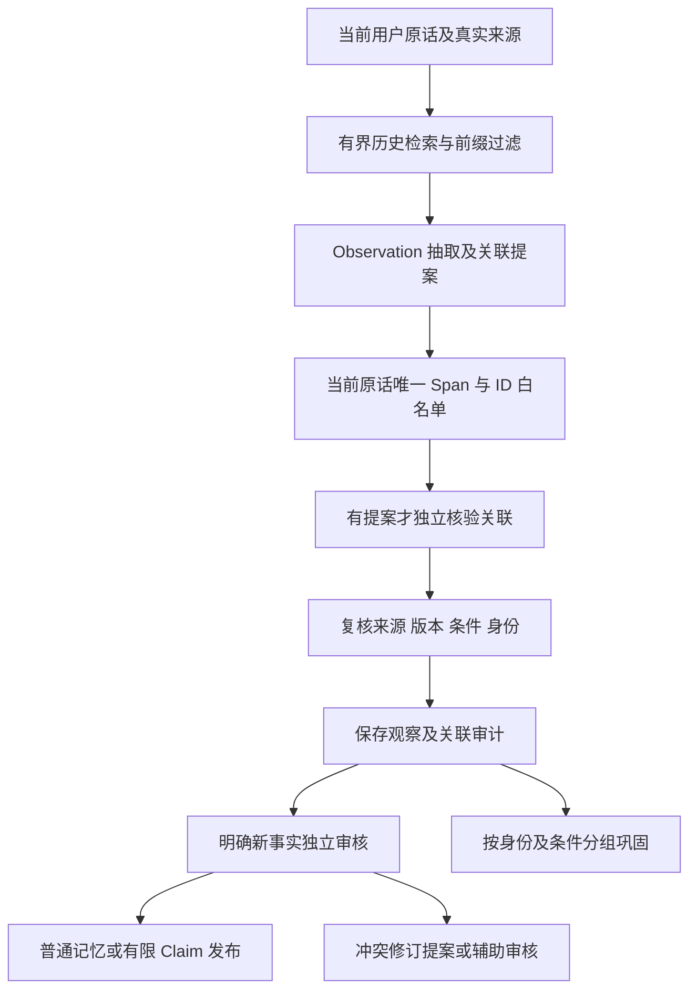

# 有界历史上下文与观察关联

[文档导航](../README.md) · [形成与巩固](记忆形成巩固与演化.md) · [研究计划62](../plans/长期陪伴记忆研究与实验计划书.md#62-有界历史上下文与观察关联2026-10-21)

2026-10-21：对话Formation不再只给观察器近期主题标签。新增[formation_history.py](../../memoria/memory/formation_history.py)，复用生产MemoryEngine的RRF检索，提供真实、可复核的历史原话与记忆；Chat/API/飞书/QQ/Telegram仍共用原Kernel、worker和审核流程。没有新建独立图谱或更换RRF。

## 处理顺序



历史只提供消歧、去重和叙事线索。新事件不能因为已有项目或相似主题被漏抽；旧记忆也不能替代当前原话证明新事件、适用条件或状态值。对“这个项目”的候选保留当前原话表达，不把旧项目名写进当前引文。关联核验和事实准入是两件事：关联被否定时，明确的当前自述仍以当前原话独立审核；无法消解的指代不会直接发布。

## 上下文上限与准入

| 内容 | 当前实现 |
| --- | --- |
| 相关记忆 | 原MemoryEngine、RRF、关闭图扩展，最多16项待过滤候选，最终最多4条；同原话拆出的记忆只保留一个上下文入口 |
| 近期原话 | 同会话最多4条之前的用户消息，排除助手、公开导入、已撤回、第三方及敏感内容 |
| 原文窗口 | 每项最多600字符，保留原文起止、完整长度及来源SHA；摘要截断明确标记 |
| 总量 | 历史模型投影及最多16个低信任主题标签合计不超过8000个JSON字符；不是精确Token预算 |
| 因果前缀 | 原话rowid及真实记录时间都早于当前来源；记忆创建/更新时间不能晚于当前来源，不读队列中后来发生的事情 |
| 有效性 | 当前账号Store内、当前有效版本、有效支持、原话角色/SHA、有限条件及已有实体范围复核；没有可用单例原文的推断模式暂不作为事实上下文 |
| 条件 | 当前原话及候选分句分别复核；未知复杂条件不借旧上下文补齐，默认与面试等例外不能错连 |

原始用户消息仍单独输入，最多12000字符；当前条件线索最多96分句，动态观察额度仍为4–12。8000字符只描述历史部分，不冒充完整调用的Token或端到端预算。远程调用、额外关联核验及延迟均进入实验计量。

## 关联提案与独立核验

Observation增加四个可选字段：

```json
{
  "linked_memory_ids": ["本轮实际提供的记忆ID"],
  "context_message_ids": ["本轮实际提供的前文ID"],
  "subject_ref": "self / unknown / memory:ID / message:ID",
  "relation": "independent / new_event / elaboration / revision_candidate / duplicate / unknown"
}
```

两组ID各最多4个，禁止未知、重复或未关联的主体ID。`unknown`且无目标是正常输入，不应导致任务失败。有提案时每条原话最多增加一次独立关联核验；返回必须覆盖本条目标，当前引文与所有目标引文逐字匹配，同时检查当前事实支持、主体和条件。缺项、坏输出、拒绝、负面判断均不批准关联；完整输出和已知/未知usage私下保存。

`verified`仅表示本次受约束的模型关联判断，不是现实身份核验。普通命名项目要求当前引文和目标原文共有明确的项目名称，不能仅凭向量相似、泛称或模型自信合并。指代只允许同会话的可见完整前文；多个项目、跨会话泛指或被截断的先行文本保持未知。首版保守地把多个含项目的前文也视为不确定，不宣称通用指代或跨别名消解。

已有来源约束实体目录仍负责规范身份，关联不会自动登记别名、创建全局实体或生成关系事实。没有实体登记时，明确关联可用实际历史引用分组；未知项目或未核验关联按当前来源隔离，不能靠同topic积成同一个Pattern。相同实体的既有分组继续有效。

## 发布、修订及失效

当前唯一引文始终绑定当前消息。普通事实和12类Claim仍走原独立LLM审核、风险/条件/时间约束、事务和期望版本检查；不把所有Observation转成Claim。

- 已核验`revision_candidate`是提案。普通自由事实保留待审，不直接覆盖目标；已绑定的有限Claim按原冲突/独立来源强化流程处理，不能由泛化关联提案绕过。
- 关联核验即使认为新旧值相互矛盾，也不能吞掉“我通常用英文交流”这样的当前明确自述。新原话继续独立事实审核；确认冲突后保留修订提案、阻断旧状态的无争议回答，撤回冲突源后才恢复。
- “维护某项目”可以形成普通事实，但缺少明确目标语义时，模型误填的`project_goal`降为普通准入，不伪造目标。
- 模型等待、向量化等待、staging、独立审核及缓存复用均复核所依赖来源/版本。上下文变化会停止不安全提交，不静默采纳旧快照。
- 依赖历史主体的观察在旧来源、目标版本、支持或实体目录变化时失效；Pattern的SQL读取也检查必要观察与历史依赖，不能等维护tick后才阻断。实体目录显式变更采用保守失效，可能比最小依赖集合更广。
- 只靠当前原话支持的字面事实可以保留；关联失效不把旧历史当其证据，也不授权沿旧主体继续归组。不会为恢复关联批量重跑个人历史。

## 保存与回查

原账号SQLite增加`memory_formation_history_runs`和`memory_observation_history`，保存实际上下文、提案、版本快照、核验及分组身份；不新增配置文件。Formation策略升级为v6，审核策略升级为v7，不把旧主题缓存冒充新上下文抽取。

当前账号`GET /api/memory-observations`增加`history`，包含关联ID、关系、未知/核验状态及身份分组；来源lineage/闭环逐题记录也包含这些元数据。过期关联不会继续以有效状态展示。模型原始响应与上下文快照留私有数据库和被忽略的实验目录，不推送。现有Studio可继续查看观察/原话，尚未新增专门的叙事关系可视化组件。

## 验证与边界

新增工程反例覆盖前缀/助手/敏感/第三方、白名单逐项隔离、条件、截断、同名歧义、异名项目、独立负面核验、缓存、模型/Embedding期间变化、立即撤回及关联失败不吞冲突。全部模拟输入扩至v6：32场景/42检查；新增唯一前文关联新事件、双项目未知指代两组，全部旧检查保留。

开发诊断保留两轮新场景失败及费用。双项目夹具的前两条初始多原子陈述改为单原子项目自述，以匹配原来保留的“两条历史记忆”上限；未删除失败问题或降低断言阈值。首轮完整模拟41/42还暴露关联核验吞掉当前冲突的回归，已补独立准入和四组故障反例；旧失败不改写为成功。最终完整验收另在本节补记。

这轮验证的是生产接线和受约束功能，不是抽取F1、实体链接精度、真实长期效果或机制收益。没有新全量LoCoMo。纯文本资料沿用已有独立来源形成；本轮新增的历史上下文入口只接个人对话Formation，跨文档叙事上下文、一般时间线消解、多主体篇章与跨会话泛指仍待后续实现和真实标签验证。

最终核心`0076e3c3`下完整工程**1314通过/532.416秒（JUnit）**，零失败、错误、跳过；整套**32场景42/42**通过，118次真实请求、132908已知tokens、165.982秒，usage未知及预算阻断0；实际本地BGE四路均召回目标，Dense/RRF实际Embedding且无降级。原始完整报告在本机`simulation/runs/20261021T152139-814c6d06`，BGE回执`offline-bge-058c025cb598`，三者代码指纹一致。

第二轮整套曾41/42因模型给new_event却省略目标导致执行失败，现将缺目标关系保留未知，不猜目标，当前字面事实继续独立审核；四类缺目标反例和两组真实检查通过后重新冻结整套。全部开发/失败与最终运行合计**409次请求/463925已知tokens**，usage未知0；不是409个正确答案，也不把最终单轮118次当总费用。795个模拟消息ID、1803个资料ID均未进入生产库；完整来源/模型原始输出仍只在本机。

生产三库备份后通过正式脚本加载当前代码，服务健康；账号/密码摘要/历史计数/凭据/绑定指纹保持，资料9张表与备份一致。原消息lineage、SQLite完整性和外键检查通过，飞书/QQ/Telegram均在线且已绑定、无连接错误。上线核对0模型调用、0生产测试来源写入，临时登录令牌撤销；实际配置、原文、数据库和运行报告继续Git忽略。

2026-10-22缓存验收发现补充边界：关联核验曾返回未被该观察提议的同源别名ID，准入又误要求旧主体原话已经包含新事件。现为每条提议提供required_target_refs，target_quotes仍严格相等；审核将当前事实原话与历史主体原话以support_roles分别展示，不传旧模型判断作为事实。准入政策升v9以避免复用旧决策缓存，未知/失效/双主体及负面判断仍辅助审核。新增多余别名反例及完整成本见[DeepSeek本轮验收](DeepSeek缓存前缀与成本审计.md)；定向通过不是最终整套通过，完整结果由本轮同指纹回执另记。


最终三重验收（核心`7a4b2103e2a6`）：完整工程**1522通过**，JUnit 813.033秒，零失败/错误/跳过；完整38场景**49/49**，134真实调用/199772已知tokens/317.548秒；实际本地BGE Keyword/BM25/Dense/RRF **4/4**，Dense/RRF实际Embedding且无降级。1299个模拟消息ID与2027个资料ID均未进入生产库。所有开发失败与费用保留，未跑新全量LoCoMo。
