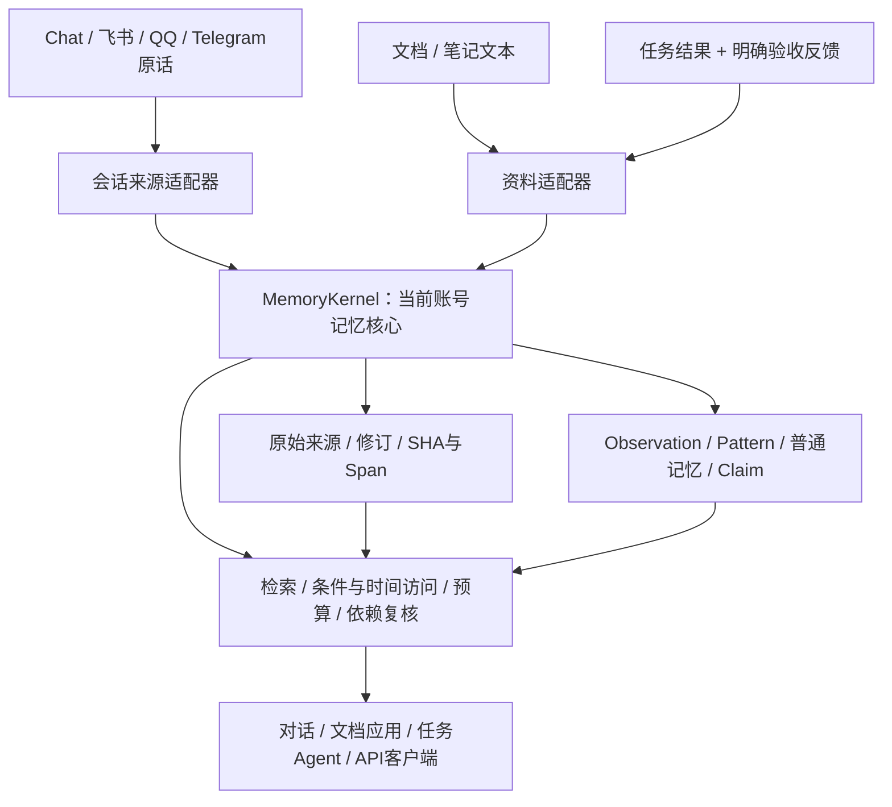

# 独立记忆核心与多来源接口

2026-10-20。[导航](../README.md) · [资料与反馈](多来源资料与任务反馈记忆.md) · [形成与演化](记忆形成巩固与演化.md) · [账号隔离](用户登录与数据隔离.md)

## 记忆的服务对象

记忆不只为聊天服务。对话、文档问答、任务执行、复盘与其他应用都可以读写同一账号下的记忆核心。Chat是消费者，Studio是管理界面，机器人是通讯入口；它们不拥有另一套事实库。核心负责来源存取、派生记忆、检索、版本、条件与权限约束，应用决定何时使用这些能力。



统一接口不等于统一成无类型向量表。原始消息、文档引文、归纳记忆、已批准Claim、任务反馈有不同语义与准入规则。本人上传文档，不证明文档在描述本人；assistant回答也不是用户自述。原Evidence / Claim / Temporal / Governance / RRF / Formation保留。

## 参考Mem0的实际代码

本地对照版本为`related-projects/mem0`的`94c3fe9f2`（Python SDK 2.2.1），检查了[MemoryBase](https://github.com/mem0ai/mem0/blob/94c3fe9f2/mem0/memory/base.py)、[Memory及身份过滤](https://github.com/mem0ai/mem0/blob/94c3fe9f2/mem0/memory/main.py)。未修改其已有本地改动，也未声称它是远程最新版本。

借鉴独立于聊天界面的add/search/get/update/history接口、明确身份过滤、原始保存与推理区分。本地这一版`_add_to_vector_store`实际是检索现有条目→一次增量抽取→批量Embedding→Hash去重→保存成功落库条目，并非每次add都执行ADD/UPDATE/DELETE的旧式决策。`infer=False`直接保存原始输入也不等于理解事实。Memoria不照搬任意文本直接变个人事实或模型直接删除，继续保留来源支持、受约束演化及撤回规则。

## 核心改造

[MemoryKernel](../../memoria/memory/kernel.py)组装原MemoryEngine、Claim、EpisodicMemory、AutoMemoryReviewer、MemoryFormation、EvidenceLibrary和记忆worker，不导入AgentRuntime、API或工具注册表。AgentService使用同一组实例，兼容原有属性；没有双份数据库、重复worker或重新迁移旧记忆。

| Python接口 | 实际语义 |
| --- | --- |
| `ingest(SourceInput)` | 原生保存note/document/task_result，不创建聊天、候选或本人Claim；修订/撤回/反馈/提炼继续使用kernel.library |
| `record_message(session_id, role, content)` | Chat/机器人运行时实际消息写入适配器，渠道由服务端message_ingress赋值；本身只存原话，正式Agent仍在原有轮次完成后入形成任务 |
| `read(domain, id, session_id=...)` | conversation/memory/library当前有效内容、表示类型、来源和依赖；旧资料版本仍由显式历史API回查 |
| `search(MemorySearch)` | 默认memory+library，原始对话需显式加入conversation；不调用LLM，个人记忆Dense/RRF可能调用配置的Embedding |
| `access(QueryRequest)` | 复用Claim条件/双时间权威访问，不由跨来源相似度裁决当前事实和冲突 |
| `dependency_valid(snapshot, session_id=...)` | 普通记忆、原话、Claim和资料统一复核；working还须匹配会话 |

LLM可省略：`MemoryKernel(settings, store, user_id=owner_uuid)`可保存、读取和词面检索，不启用形成/自动审核worker，明确提炼返回503。需要形成/提炼时传LLMClient。Store及账号UUID由可信宿主选择；Python接口不另做Web登录，不能拿请求参数直接拼任意用户数据库。独立客户端保存原话不自动批准事实，仍须明确使用现有提取/审核流程。

构造核心不会自动启动后台任务；正式HTTP服务仍在原生命周期调度同一记忆worker，独立宿主需明确管理任务生命周期与Store关闭。

```python
from memoria.memory.kernel import MemoryKernel
from memoria.memory.records import MemorySearch

# settings / store / owner_uuid由正式网关或可信宿主提供。
kernel = MemoryKernel(settings, store, llm, user_id=owner_uuid)
result = await kernel.search(MemorySearch(
    query="来源版本校验", domains=["library", "conversation"],
    session_id=owned_session_id, limit=6, budget_chars=8000,
))
# 应用可继续处理文档或任务，无需先发起Chat。
```

## 证据读出与预算

[records.py](../../memoria/memory/records.py)统一返回domain/source_id/representation/content/start/end/citation/provenance；服务器依赖在dependencies。conversation为message_quote，保留角色、真实渠道、记录时间及personal_evidence_eligible，未知事件时间仍null；资格字段不代表已审核事实。memory是derived_memory，不冒充原话；library是source_quote，保留作者声明、范围、版本、SHA和有效知识观察。

个人记忆仍按所选Keyword/BM25/Dense/RRF检索；资料仍为BM25，允许同来源最多两个片段；原始对话复用现有消息词面检索。跨来源按各自内部排名轮转，给非空来源留展示机会，不直接比较BM25与cosine，也不把轮转称作新的RRF。limit限制总片段数，候选池/宽度有界，不保证搜齐全部历史或必要互补证据。

预算为**完整JSON字符数**：引用、来源元数据、知识观察、依赖和选择诊断均计入。报告candidate_count/selected_count/skipped_budget/skipped_stale及实际字符数；超额整条候选不入选，不截断JSON或伪造半段引用。空结果可能因预算不足，不能据此断言库内没有资料。source_rank属于自身来源通道，不能跨通道解释为同等相关性。span为Python字符串字符位置，非UTF-8字节或Token；最终模型输入仍受ReaderBudget约束。

选择前同一Store锁内复核来源状态/范围，Embedding等待后重查会话。修订、撤回或反馈变化阻止旧证据发表；使用期间仍应在发布前重验dependencies，检索有效不承诺永久有效。

## API与真实消费者

新API均在正式网关后，Cookie/Bearer选择UUID；请求体不能传user_id/agent_id选择他人。

| API | 用途 |
| --- | --- |
| POST `/api/memory-kernel/sources` | SourceInput，201原生保存，与旧`/api/library/sources`共用kernel.ingest |
| GET `/api/memory-kernel/sources/{domain}/{source_id}` | 当前有效完整内容与依赖；working须提供匹配session_id |
| POST `/api/memory-kernel/search` | MemorySearch，返回证据/依赖/完整预算/选择诊断 |

MemorySearch：query 1–2000字符且非空白；domains是不重复的memory/conversation/library；session_id可选且须属本账号；limit 1–16；budget_chars 800–16000；memory_mode为keyword/bm25/dense/rrf。无session_id不读working；本人其他会话历史仍可跨会话查询。

[实际聊天工具](../../memoria/tools/knowledge.py)新增只读search_knowledge，默认memory+library，原话需明确conversation；模型不能传账号/会话，使用RequestContext。search_library为按需发现的library兼容入口，同用核心。两者复用每轮调用/字符预算，超额原子拒绝。修复旧AgentRuntime另维护名单而遗漏search_library响应内容记账的问题。

## 验证与边界

最终受影响工程组**364项通过/121.47秒**，覆盖核心、资料、形成/审核、聊天/机器人、Claim、完整Reader、账号隔离、来源撤回、模型配置和工具预算。原213项与121项阶段集合相互重合，不相加。独立导入检查确认核心不导入runtime/api/tools。正式网关的新检索与OpenAPI通过，当前原生资料0来源，未写生产测试资料；账号/密码摘要/历史与原机器人绑定和凭据指纹保持，部署前备份3份SQLite。完整记录见[总计划51](../plans/长期陪伴记忆研究与实验计划书.md#51-独立记忆核心与多来源读写2026-10-20)。工程输入仅在系统临时SQLite，无收费LLM调用、无新全量LoCoMo，历史成绩不变。

当前仅文本/Markdown和明确任务反馈；PDF/Office/图片/音频解析、文件监控、自动MCP采集、资料Dense、通用插件注册和跨来源事件队列未实现。统一核心与读出不等于任意格式导入或语义推理已完成。普通资料问答尚无个人Claim的完整逐句CitationGuard，文档中的指令仍须按低信任数据处理。

下一步优先**来源感知形成**：本人笔记、外部知识、任务经验各自的Observation准入、独立证据/反证、跨资料巩固、更新/降级和撤回重放；不能把所有文本送同一“提取用户偏好”提示词。之后用相同Reader与总预算验证，成本覆盖形成/审核/索引/回答。长期效果、抽取F1、资料提炼precision及任务迁移收益仍未知。
