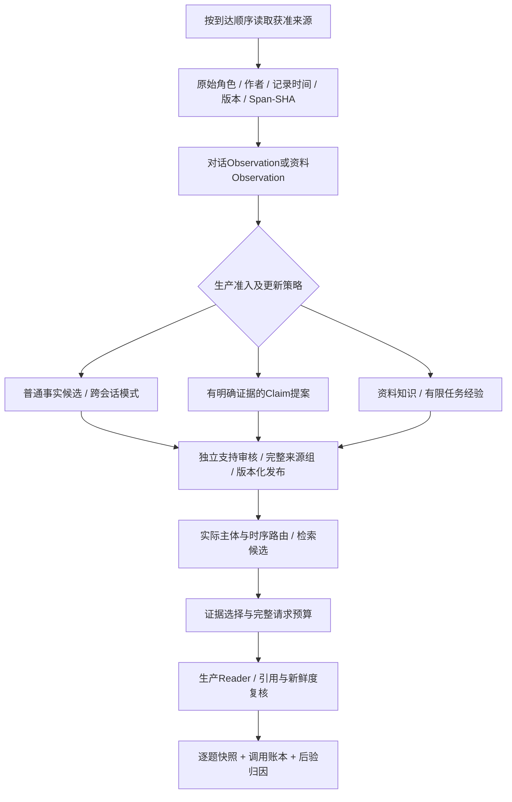

# 生产记忆闭环与逐题归因

2026-10-20。[导航](../README.md) · [既有冻结重放](生产重放与普通来源支持.md) · [形成与演化](记忆形成巩固与演化.md) · [文本来源](文本解析与跨资料记忆形成.md)

## 这次接通了什么

原LoCoMo full仍使用PrefixRetriever及原话Reader，**没有因本次变更变成生产Claim/View闭环成绩**。此前capture-production/replay-production继续只做冻结副本访问和固定候选重选。新closed-loop入口从空的隔离数据库重新执行正式MemoryKernel、MemoryJobWorker、Formation、AutoMemoryReviewer、Claim/View、选择器和Reader；不补人工批准，不调用另一套benchmark提取器。

逐题QA调用生产记忆API的个人/资料回答路径，target须按预先任务协议声明。它不重演整个Chat的工具规划、MCP、Skills或机器人网络；Chat及机器人另有同组件旁路审计。不得把显式personal调用说成自然语言Chat路由已经正确，或把隔离词面配置说成当前Dense部署的同配置成绩。



不是所有Observation都成为Claim。明确持久自述经过原审核器，只有符合槽位/主体/条件/时间约束的简单事实才提出Claim；普通经历、interest/behavior观察和推断模式保持自己的类型。状态冲突仍保留待辅助与修订策略。外部文档不成为本人事实，公开语料不进入真实账号的本人证据库。

这次还补齐受约束修订提案：通过模型支持和服务器证据约束、但与已批准单值槽位冲突的候选，在原审核记录中保存目标Claim/revision、候选SHA、原话及未知事实时间，不自动修订。当前状态读取遇到仍有效且匹配目标版本的提案时clarify；历史读取不被改写。生成期间出现提案也会在发布前拦截，候选被拒绝/来源撤回/目标版本改变后旧提案不能继续阻塞。复杂条件/时间等原风险闸门没有因此放开。

仅批准普通记忆不能当成已完成Claim修订；相应提案仍要求结构化治理。原已批准版本可在历史/诊断接口回查，不能因此跳过当前状态回答的冲突检查。

## 统一生产回答与审计

[MemoryKernel.answer](../../memoria/memory/kernel.py)是可信宿主的回答入口：

| 请求 | 实际路径 |
| --- | --- |
| QueryRequest | 原read_memory_answer → MemoryAccessOrchestrator → Claim/View或合法原话补检 → 原CitationGuard |
| KnowledgeAnswer | library域统一检索 → 来源证据Reader；完整必要引文/主体/反馈随包进入预算，生成前后复核依赖 |

对应正式登录API：原`POST /api/memory-answer`现经Kernel；新增`POST /api/memory-kernel/knowledge-answer`。后者默认且仅允许library域，个人状态用QueryRequest，普通多域召回继续用search。避免把没有完整展示原始支持的普通推断当作已核验个人状态来回答。

资料Reader只接受严格JSON、已展示的完整citation、完成的输出和仍有效的当前账号来源。凭据样式不发送；未知/重复/漏引用、原文撤回、反馈或版本变化均不能发布原结论。引用检查**不等于逐句语义蕴含**，validation仍明确semantic_entailment_verified=false。没有将新资料Reader宣传为完整语义CitationGuard。

回答中的closed_loop包含：主体、实际route、冷查询compiled_view_id/热查询view_id、候选与选择ID、对应的来源及Claim revision、选择成本/丢弃诊断、Reader调用/预算/usage、最终引用和校验、答案SHA及整条trace指纹。来源快照保留观察、审核原因、发布对象和版本引用，不复制完整原话正文。

新自动审核记录绑定实际applied_claim_revision_id，来源链据此标记LLM准入；重用已有状态不伪造一次新批准。旧Claim的verification_status历史名称不能当作独立真人标注；缺少可核对的旧审批元数据时保留unknown_from_legacy_metadata。

`GET /api/memory-kernel/lineage/{conversation|memory|library}/{id}`只读当前账号来源链，无模型调用。不存在/他人账号的ID仅返回available=false，不读取他人库。它是**当前元数据快照**，不从后来状态倒推过去；评测必须在题目执行时冻结快照。普通记忆展示完整支持组及其对话来源；资料的原件、修订和形成账本仍在原库。

Chat与三个机器人共用的AgentRuntime也记录memory_closed_loop。初始普通召回及search_knowledge/search_library保留实际候选/工具选择；每个Reader请求记录来源片段可见性、请求SHA、返回/失败、未知usage、重试和耗时。普通自由对话没有严格引用契约时明确标记valid=null；工具返回过不等于Reader完整看到，字面片段可见也不证明语义充分。故障trace保留失败阶段，不将网络错误当合理拒答。

事务水位扩展覆盖形成调用/审核评估、library来源/原件/反馈、观察/审核与巩固版本。安装前历史不补造，事务回滚不会留下虚假事件。原话Span/SHA、expected revision及版本审批约束没有放宽。补强了对话形成/审核的finish_reason检查：即便JSON看似完整，length/tool输出也不得发布事实。

## 小规模闭环执行

入口在原[production_replay.py](../../memoria/experiments/production_replay.py)，不是新的记忆算法。使用原四类配置及账号模型配置，不新建模型配置文件。原始资料、prompt、答案、SQLite、账本和逐题trace全部保留在当前账号Git忽略的experiments下。

```powershell
# 第一步只验证输入，0模型调用，不创建运行数据库
.\.venv\Scripts\python.exe scripts/research.py --user YOUR_USER closed-loop --input .\data\closed-loop-input.json
# 显式执行，小规模付费上限；本轮不运行全量LoCoMo
.\.venv\Scripts\python.exe scripts/research.py --user YOUR_USER closed-loop --input .\data\closed-loop-input.json --execute --allow-remote --max-calls 4 --max-input-chars 60000
```

输入结构由ClosedLoopInput验证：schema_version=1、provenance、allowed_purposes同时声明memory_processing/evaluation、可选subject_key、events。不得加入答案/gold/证据标签。实际用途授权和身份声明由资料提供者负责，程序不把声明当独立现实核验。

| event.kind | 必需内容及语义 |
| --- | --- |
| message | id/session/actor/role/content，可选original_time；user原话必须匹配明确subject_key，其他人物分别运行，不猜测同名人物或将匿名对话拼成人设 |
| source | id/body，body为原SourceInput；form默认true，最多尝试8个12000字符段；任务结果先form=false保存 |
| feedback | id/source/content/outcome，绑定此前资料的当前修订；unknown不变成成功经验 |
| revision | id/source/content、可选title，通过原expected revision保存新版本 |
| form | id/source、可选start/max_chars，对当前资料/反馈显式形成；任务先feedback再form，修订后也需重新形成 |
| retract | id/source，通过原消息撤回或资料撤回机制，不物理删除历史 |
| question | id/target=personal或knowledge/request；request只用生产字段，个人问题不得手填gold槽位/条件/时间/实体答案；由自然语言解析 |

events按到达顺序执行，最多64步、1–10题。题目前只入库其来源前缀，后续资料不会提前成为模型上下文。不同真实人物采用单独绑定与隔离运行；这不是新的通用实体消歧算法。缺失original_time仍为未知；已提供时间保留在输入/事件来源账本，生产recorded_at使用实际重放写入时间，不回填原历史或伪装时间旅行。因此不能凭此入口宣称已复现历史墙钟下的双时间效果。

默认使用明确登记的隔离JSON/词面配置，禁用Embedding，不能当生产Dense/RRF同配置成绩。显式--local-embeddings仅接受已配置本地BGE；不偷偷调用远程Embedding。远程模型须--allow-remote；所有LLM请求经过同一计数器，max_calls=1–32，默认12，默认累计输入字符上限120000、单次输出最多1800 token、模型重试0。字符上限不是精确Token或金额预算；预算阻断、未知usage、上游失败及后续未执行题保留在分母，不能报为正常拒答或零成本。

产物：input.json、source-map.json、isolated-memory.db、cases.jsonl、events.jsonl、prompts.jsonl、calls.jsonl、metrics.json和带代码/配置/指纹的manifest。关库后才冻结文件指纹，避免把会消失的SQLite WAL/SHM当永久产物。calls账本覆盖抽取、审核、巩固、查询模型及Reader；单个回答的usage不能冒充整条链的总成本。Studio仍只列运行概况，逐题钻取在私有产物中，未新增原话/gold公开展示。

## 后验归因

```powershell
.\.venv\Scripts\python.exe scripts/research.py --user YOUR_USER attribute-closed-loop --source-run RUN_ID --judgments PRIVATE_LABELS_PATH
```

独立文件声明reviewer/provenance/cases，每题一个CaseJudgment，包括错误题；cases含case_id、可选support_groups（组内AND/组间OR）、required_route以及可选stage_judgments。后者的键仅限extraction/publication/retrieval/selection/reader/answer，值为明确的布尔判断；未标注不填、不猜false。AI辅助声明不能冒充独立真人。

labels仅在预测run已结束、全部产物SHA和owner验证后读取；输出新的归因run，不修改预测、原始成绩和调用账本。不能用未来来源当当前题证据。诊断可见原文不可用、形成/审核/发布缺口、未召回、候选未选、Reader未执行/执行失败/契约失败、拒答与未评分回答。给出哪组必要证据在召回/呈现处缺失，保留每阶段语义未知；若有真实阶段标签，再定位相应负例。

**来源ID覆盖不是文本充分性；没有标注就不能自动判定抽取内容正确、审核错拒或最终回答语义正确。** publication_or_governance_gap要求结合快照里的jobs/observations/reviews/published细分；敏感冲突被正确拦截不是存储bug。日志提供可检查的完整链，不把最早可见的失败当已证明的因果贡献，也不把某题答对就说Claim一定起效；实际route/claim revision/View须同时参与。

## 验证与剩余工作

受影响回归与限额真实调用见[总计划53](../plans/长期陪伴记忆研究与实验计划书.md#53-生产形成审核访问与reader闭环2026-10-20)。工程临时用例覆盖真正的自动Claim发布、冷/热View、角色/未来前缀、任务反馈、撤回、审批/长度失败、预算分母、跨账号和篡改。替身不充当研究数据或F1。

真实检查仅用6f163e9公开README的5953字符：资料观察/核验/Reader共3次模型阶段调用，已知10930 tokens、未知usage 0、0重试，1题完成、2候选/2选择/1引用、0生产资料写入。全部私有账本保留。它是未评分的来源闭环检查，**没有个人Claim/View、没有跨资料巩固、没有新的LoCoMo全量或长期效果结论**。

下一步是获准真实连续来源及抽取/审核/必要支持/反证标签，在同Reader同总预算下比较原话检索、普通形成、加Claim/View、加巩固演化。当前入口是受限自述/资料协议；LoCoMo多人物与历史时钟的正式适配、完整12槽位自动修订、通用实体合并和严格逐句语义核验仍待实现/验证。冻结LoCoMo表不改写，真实长期效果与抽取F1继续未知。
