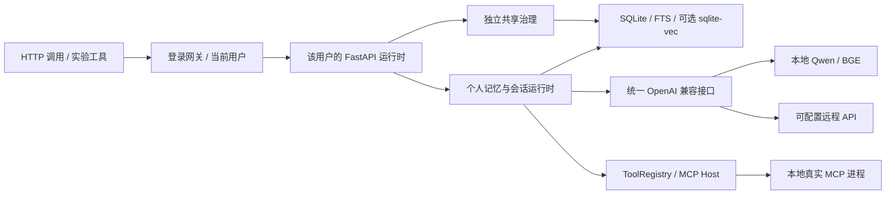

# 已实现的系统架构

核对日期：2026-10-11。本文只描述现行代码；路线见 [研究计划](../plans/长期陪伴记忆研究与实验计划书.md)。聊天前端已移除，服务根路径返回 API 入口；交互式接口说明在 `/docs`，OpenAPI 在 `/openapi.json`。

## 配置和运行

`main.py` 启动 Uvicorn；`memoria/config.py` 读取 TOML、extends 和环境变量，支持 main、fast、embedding。私人 `config.toml` 被忽略，`config.example.toml` 不含密钥。`data/config/models.override.toml` 可覆盖模型配置，正式网关为每个账号指定独立 DB、Markdown、MCP 与模型覆盖文件；旧数据库不自动导入。详见 [用户隔离](用户登录与数据隔离.md)。

依赖只安装到 `.venv`；MCP 的 npm 依赖与原生二进制安装在 `.mcp/node` 与 `.mcp/github`。模型权重在 `model/`。本地服务 `memoria/llm/server.py` 提供 `/v1/chat/completions`、SSE、工具调用和 `/v1/embeddings`；范围见 [统一接口](本地与远程OpenAI统一接口.md)。

## 个人记忆链路

消息落库 → 检索门控/规划 → 当前或历史有效区间约束 → FTS/中文 BM25/Dense → RRF 与一跳图扩展 → 分层、来源片段和预算约束 → reader/工具循环 → 保存回复、trace 和任务情景 → 租约 worker 抽取候选 → 审核批准后写入有效记忆。

候选先进入 memory_reviews；未批准记录不进入长期召回或 Markdown 投影。类型为 fact/preference/profile/goal/procedure。人工纠正新增版本，事务同时维护来源、替代、有效区间、FTS 和父/块向量；撤销可恢复此前来源仍有效的版本。来源账本防止同一来源重复强化。[一致性说明](记忆一致性与检索审查.md)涵盖迁移与恢复边界。

长文通过 BGE tokenizer 分块，原文连续 span 覆盖全文，每块最多 512 token（含 special token）。父记忆仅一份正文/版本，检索用最佳块给父记忆评分并提供 excerpt。[分块说明](实验记录与长记忆分块索引.md)区分完整索引与最终 prompt 可见内容。

## 分层、治理与来源

工作层限制上下文；情景层保存实际任务/对话片段；语义层保存审核事实；程序层与 Skills 复用经确认的方法；遗忘、纠正、过期贯穿生命周期。[分层配置](记忆分层与配置.md)说明 TTL、容量和预算，这些默认值不是研究效果保证。

共享治理使用 agents/spaces/grants/proposals/governed_memories/events 独立表与 `X-Agent-Key`。提案和审批重验权限及本地来源，CAS 防止并发覆盖。授权 SQL 候选内进行词面/BM25 检索；共享层尚无 Dense，个人运行时现已按登录用户隔离，共享空间仍是每用户库中的独立 Agent 治理域；跨登录账号共享尚未实现。[共享边界](记忆治理与多Agent共享记忆.md)。

来源接口可回查原消息、会话及上下文。来源存在不证明陈述真实，当前没有通用 evidence span/NLI 支持度检查；这属于计划。

## 工具与可观测性

ToolRegistry 执行 schema 校验、授权、超时和输出裁剪；Tool Search 避免一次把全部工具放进小模型上下文。MCP Host 管理 stdio 服务、白名单、并发初始化和 reload；本机接入方式与认证状态见 [MCP 部署](MCP部署与授权.md)。

轻量 Pipeline/EventBus、会话压缩、SSE/取消、后台任务租约与受预算限制的空闲 Drift 已存在。Drift 默认关闭，只做内部整理；外部通道、对外主动推送及动态插件市场尚未实现。

trace 记录召回来源/计划、模型 usage/重试、工具授权、阶段墙钟和可见文本 TTFT；`/metrics` 可供 Prometheus 抓取。实验账本记录代码、数据/模型 SHA、实际调用、失败和产物摘要。嵌套阶段有重叠，不能求和冒充总耗时或纯 GPU 时间。

## 代码定位

| 路径 | 职责 |
| --- | --- |
| `memoria/store.py` | SQLite、版本/来源/区间、索引、任务租约 |
| `memoria/memory/` | 编码、分块、检索、抽取审核、分层生命周期 |
| `memoria/prompting/` | 分层帧与预算 |
| `memoria/runtime/`、`service.py` | 请求编排、工具循环、取消 |
| `memoria/governance.py`、`api/governance.py` | 独立共享治理与鉴权 |
| `memoria/llm/` | 本地/远程模型适配和兼容服务 |
| `memoria/mcp/` | stdio 传输、配置和工具注册 |
| `memoria/experiments/`、`observability/` | 真实实验账本、trace 和计时 |
| `scripts/` | 模型下载/启动、真实语料准备、MCP 安装/授权/验证 |
| `tests/` | 工程测试；临时输入与替身不作为研究数据 |

接口参数以 [API 文档](API接口文档.md)和运行中的 OpenAPI 为准。当前没有正式长期陪伴准确率或规模 SLO；没有把历史合成样例成绩保留为产品指标。
