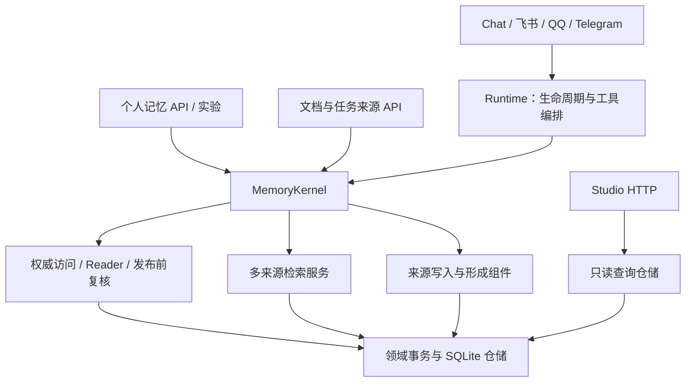

# 统一内核入口与存储边界

2026-10-21。[文档导航](../README.md) · [独立核心](独立记忆核心与多来源接口.md) · [生产闭环](生产记忆闭环与逐题归因.md) · [主计划第65节](../plans/长期陪伴记忆研究与实验计划书.md#65-统一内核入口与存储边界2026-10-21)

## 本次修复的真实边界

改造前的 AgentService 实际已经给 Runtime 注入 Kernel，不能据此说所有真实 Chat 都没有 Kernel。风险在于业务代码仍允许缺失 Kernel 时另造 Orchestrator、直接读写 Store；普通个人记忆问题还在 Runtime 内单独组装 Reader，只有复杂自适应问题提前进入 Kernel.answer。入口、提示上下文、发布检查和记录方式因此有分叉。

现在生产 Runtime 和工具构造必须提供当前租户的 Kernel。个人记忆回答统一进入 Kernel.answer，API 与实验不再在业务层另造 Reader/Orchestrator。一般聊天、技能和工具执行仍由 Runtime 编排：其记忆召回和依赖检查通过 Kernel，普通聊天不冒充结构化个人事实问答。

唯一允许缺失服务的场合是 `schema_only`：它用于生成 OpenAPI，不建立 Store 或启动服务；记忆路由的依赖检查返回503，不会选择另一套算法。正式网关仍以认证账号 UUID 选择租户，模型或请求体不能选择别人的数据库。

## 模块责任

| 模块 | 责任 |
| --- | --- |
| [kernel.py](../../memoria/memory/kernel.py) | 租户记忆门面；不写 SQL、不给 Store 动态挂实体属性 |
| [ports.py](../../memoria/memory/ports.py) | 宿主可依赖的读/写 Protocol，接口不要求暴露 SQLite 连接 |
| [bootstrap.py](../../memoria/memory/bootstrap.py) | 显式构造一组组件；不导入 Runtime/API/工具、不启动后台任务 |
| [search.py](../../memoria/memory/search.py) | 原多来源检索、身份/时间约束、完整 JSON 预算及选择，保留原算法 |
| [publication_policy.py](../../memoria/memory/publication_policy.py) | 同一事务内检查待发布修订、预期版本、候选指纹和当前证据 |
| [publication.py](../../memoria/memory/publication.py) | 已验证 Reader 结果在宿主发布前再次复核；阻止后置改写和失效来源 |
| [reader_calls.py](../../memoria/memory/reader_calls.py) | 普通个人/资料 Reader 的实际请求、原始返回、usage、耗时和失败记录；请求观察器使用任务局部 ContextVar |
| [persistence/](../../memoria/persistence/README.md) | Studio/形成投影、账号、渠道收件箱、审核及资料原始记录的 SQLite 适配器 |

Store 的 `entities` 是明确声明、加锁初始化并缓存的实体索引属性。索引依赖原始资料仓储，不需要宿主或 Kernel 先执行 `store.entity_catalog = ...`。来源、Claim、实体模块分别安装自己的追踪规则，门面不再注入 observability。实体身份、别名、撤回约束继续生效。

账号和渠道状态类原先已经属于持久化适配器，不能只因包含 SQL 就认定它们是两套业务实现。本次将其明确命名为 SQLiteAccountRepository/SQLiteChannelRepository，并移到 persistence；原 AccountStore/ChannelState 导入名保留为同一个类的导出。没有复制查询逻辑或改动密码、绑定、重放保护和事务策略。模型热配置改由Kernel替换同一份Embedding客户端并切换索引命名空间，Service/Runtime/worker继续引用同一MemoryEngine。

业务层的 SQL 已收拢：API、渠道适配层、公开账号模块及 Kernel 没有直接 `.db.execute/executemany/executescript` 调用。Claim、治理和其他记忆领域仍保留 SQLite SQL 与事务；这不是已经完成 PostgreSQL、多机事务或通用存储后端适配的声明。

## 生产 Reader 与发布

普通个人问题现在与 `/api/memory-answer` 使用同一个 Kernel Reader，只呈现当前查询与经选择的证据，不把近期未批准对话或压缩摘要另塞进个人事实 Reader。完整 ReaderBudget、引用/Span/SHA、当前版本、主体条件以及来源撤回检查继续生效。复杂问题保留原有一次有界补检和完整调用预算，不增加新的模型判断步骤。

Runtime 先保存一份与钩子元数据隔离的 Reader 结果。钩子执行后由 Kernel 再验来源；改写答复被拒绝，篡改显示用引用或闭环元数据不能改变待发布结果。严格记忆回答只在检查后发送最终文本；一般工具聊天仍按原依赖规则决定是否缓冲。思考/工具流和账号入口没有重写。

Reader 调用日志记录的是 Reader 管线的应用层尝试；异常不能据此断言供应商未接收请求。查询模型、Embedding、独立重排及形成/审核沿用各自账本，不将不同账本重复求和。自适应链仍保留自己的完整阶段记录。实际模型尝试触发 TTFT 标记，不能把请求完成时间当成开始时间。

生产副本重放也构造 Kernel；只在冻结副本迁移/建索引，禁用 Markdown 写出，不写生产文件。实体消融的 Reader 阶段直接调用 Kernel.answer；该实验显式关闭自适应，避免把检索方法消融混成补检策略对比。资料重排实验仍使用显式冻结候选池，这是实验控制，须在协议中注明。

**旧 LoCoMo PrefixRetriever 协议仍是独立基线。** 本次统一不能追认旧分数已经测过生产 Claim/View、形成或发布机制。没有运行新的全量 LoCoMo，也不把工程通过称作真实长期效果、抽取 F1 或质量收益。

## 拆分与兼容

| 范围 | 改造前实际本地代码 | 当前 |
| --- | --- | --- |
| api/app.py | 1101行，业务路由集中 | 352行；仅组成租户应用、生命周期、中间件和健康入口 |
| Runtime.run | 492行 | 约261行；上下文准备、工具推理、个人记忆发布各自独立 |
| kernel.py | 323行，夹带检索、SQL和组件注入 | 257行，门面无直接 SQL；最长行108字符 |

行数按本次格式化后的代码统计，只说明代码组织。请求模型移入 schemas，路由按会话、记忆、形成、情节、集成和状态拆分；68个原租户 HTTP 接口的路径、方法、处理器名和响应状态有冻结契约检查，网关仍保留既有认证及公开健康接口。

## 验证与下一步

新增21项工程检查也实际经过三个机器人的租户chat_turn入口，检查渠道原话及形成任务入队。其余覆盖 Kernel 必需依赖、5类消息入口与 API 同一 Reader、状态工具同一发布策略、来源/钩子失效、元数据隔离、未批准历史隔离、任务局部观察器、只生成 schema 时拒绝服务、旧路由契约以及业务 SQL/大函数边界。

最终核心指纹`007cca9465fd`：完整工程 **1462项通过**，JUnit733.784秒，零失败/错误/跳过；完整固定输入v8 **38组49/49**，133次应用层模型调用、188100已知tokens、238.928秒，零未知usage/预算阻断/执行失败，生产写入0。实际本地BGE Keyword/BM25/Dense/RRF **4/4**，Dense/RRF均`dense_available=true`、无fallback。三项验收使用同一最终代码与测试指纹。

开发首轮完整工程1458项中1452通过、6失败：路由树白盒定位2项、耗时记录1项、模型热配置1项，以及账号/渠道测试仍替换旧模块2项。进一步检查恢复了路由拆分时遗漏的机器人chat_turn绑定，并补充真实转发入口、形成入队与热配置检查；修复后61项定向通过。取消与密码重置竞态的原断言保留，未将失败测试跳过。

首轮核心`bdfdf325347d`的模拟也为49/49，但未作为最终验收。两轮完整固定场景共266次应用层调用、376245已知tokens；失败工程、定向修复及两版模型原始返回均保存在本机忽略目录，不提交私人轨迹，不把旧版成功叠成新版成绩。

本机部署前完成3份一致SQLite备份，重启后台PID53212；Chat、Studio、认证路由与OpenAPI正常，旧消息lineage及SQLite/FK核对通过，资料来源/原文件/审核/版本等9表与备份一致。账号、密码摘要、角色、历史、凭据和绑定保持；飞书/QQ/Telegram均在线、已绑定且无错误。部署核对0模型调用、0生产测试来源写入，临时认证令牌已撤销。1143个模拟消息ID与1950个模拟资料ID均未进入生产库。

下一阶段优先用同一 Kernel 和完整预算进行生产链路小规模标签对照，分别统计原始来源召回、Claim/View 适用性、必要证据组、Reader 和发布失败；普通任务聊天单列。存储后续先将剩余领域查询按聚合边界封装，再评估迁移收益，避免拆散 expected-revision、不可变修订及完整支持组的同一事务。
